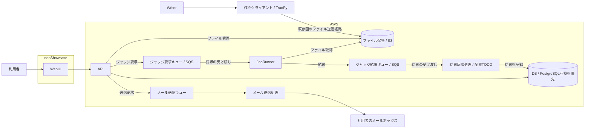

# 製品の位置づけ

## システム構成

WebUI は neoShowcase、API・DB・ジャッジ基盤などのクラウド側要素は AWS に配置する方針とする。API のインスタンスや実行サービスは未決であり、特定の製品を要求しない。

矢印は論理的な処理・データの経路であり、キューのプッシュ通知やポーリングなどの通信実装を確定するものではない。結果反映処理とメール送信処理は責務を示すノードであり、別サービス・別インスタンスへの配置を要求しない。

## 接続関係

| 接続 | 分かっている責務 | 未決事項 |
| --- | --- | --- |
| WebUI・クライアント → API | 操作の受付と結果の取得 | 公開URL、認証情報の受け渡し、対応操作 |
| API ↔ DB | 構造化データの永続化 | DBサービス、スキーマ、接続方式 |
| API・クライアント ↔ ファイル保管 | 提出ソース・作問ファイルの保管 | アップロード経路、確定手順、アクセス権 |
| API → 要求キュー → Runner | ジャッジ実行の依頼 | メッセージ契約、ファイル参照の渡し方 |
| Runner → 結果キュー → 結果反映処理 | 判定・得点を記録へ反映 | 反映処理をAPI内に置くか独立させるか |
| API → メールキュー → メール送信処理 | マジックリンクの送信 | 配送サービスとメッセージ契約 |
| 認証機能 ↔ 外部認証先 | Google・GitHub・traQの連携が既存APIに存在 | 採用範囲と、API・neoShowcase間の責任分担 |

## 未決事項

- TODO ARCH-01: 認証機能・結果反映処理・メール送信処理の配置と、APIとの責任境界を決める。
- TODO ARCH-02: DB・S3・各キュー間のデータ参照と受け渡し契約を決める。
- TODO ARCH-03: 外部公開する入口と内部通信の経路を決める。
- TODO ARCH-04: 既存のサービス構成図へ配置変更と周辺要素を反映する。
