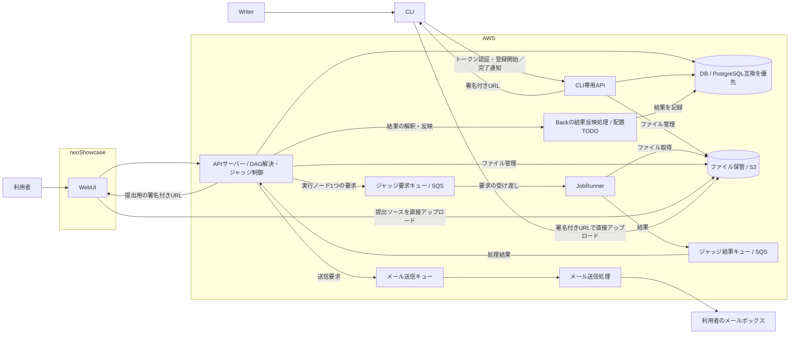

# 製品の位置づけ

## システム構成

WebUI は neoShowcase、API・DB・ジャッジ基盤などのクラウド側要素は AWS に配置する方針とする。API のインスタンスや実行サービスは未決であり、特定の製品を要求しない。

AWS側はAPIとインフラをまとめて[構成ブロック](../../services/aws-building-blocks.md)へ分解して議論する。以下の図は論理的な経路を示し、具体的なAWS構成候補・データの所有・接続ごとの判断事項は同資料にまとめる。

矢印は論理的な処理・データの経路であり、キューのプッシュ通知やポーリングなどの通信実装を確定するものではない。結果反映処理とメール送信処理は責務を示すノードであり、別サービス・別インスタンスへの配置を要求しない。

CLIは問題登録を担う独立した担当分野とし、CLI専用APIを提供する。WebUI等のAPIとCLI専用APIのノードは操作インターフェースの区別を示し、別プロセスへの配置を要求しない。CLI専用APIが権限確認と署名付きURL発行を担い、CLIがS3へ直接アップロードしてAPIへ完了通知する。既存構成図のTraoPyをCLIの実装として採用するかは未決である。

CLIからの登録データは、DAG・実行環境を含むメタデータと、全テストケース・テストコード・問題得点計算ロジックを含むファイル集合の組とする。詳細参照先と未決の接続契約は[問題登録・ジャッジ実行の受け渡し仕様](../14-specified-requirements/01-external-interfaces/problem-registration-contract.md)に記す。

WebUIの提出ソースも、APIが発行する署名付きURLでブラウザからS3へ直接アップロードする。提出の確定とジャッジ依頼はBackが担う。

実行基盤はサービスのDBを直接読み書きしない。要求・結果はSQSを介して受け渡し、必要ファイルはS3から取得する。DAGの解決・実行順序の制御・結果の解釈とDB反映はAPIサーバー担当、実行環境の定義・構築・配置・運用はインフラ担当が担う。要求する処理はDAGの実行ノード1つずつとする。制御処理のプロセス配置は未決とする。

Backがジャッジ要求を作る時点で、使用する問題・ジャッジ定義・ファイルの版を固定する。待機中・実行中の問題更新で、その要求の実行内容を変えない。更新版を使う場合は別の実行要求とする。

Backが要求ごとに一意の実行IDを発行し、Judgeは結果に同じ実行IDを付けて返す。再ジャッジは別の実行ID、同じ要求の再配信は同じ実行IDとする。

ジャッジ定義と、提出コードのS3参照・提出言語などを追加するジャッジ実行要求を区別する。APIサーバーが固定した定義に提出固有入力を適用して実行手順を具体化し、DAGの依存関係に従って実行基盤へ処理を依頼する。

提出コードのS3参照には、保管先・オブジェクトキー・必要な版情報を持たせる。Judgeの実行基盤の権限でS3から取得する。

同じ実行IDの同じ結果が複数回届いても、Backが一回分として反映し、得点や結果を二重計上しない。

## 接続関係

| 接続 | 分かっている責務 | 未決事項 |
| --- | --- | --- |
| WebUI・クライアント → API | 操作の受付と結果の取得 | 公開URL、認証情報の受け渡し、対応操作 |
| CLI ↔ CLI専用API・ファイル保管 | 開発者トークンでAPIを利用し、署名付きURLでS3へ直接アップロードしてAPIへ完了通知 | 対応操作の全体と、更新確定などの詳細契約は未決 |
| API ↔ DB | 構造化データの永続化 | DBサービス、スキーマ、接続方式 |
| WebUI・API ↔ ファイル保管 | APIが署名付きURLを発行し、ブラウザが提出ソースをS3へ直接転送。Backが提出確定・ジャッジ依頼を担当 | 確定の通知方法、検証・アクセス権の詳細 |
| APIのジャッジ制御 → 要求キュー → Runner | APIサーバーがDAGを解決し、実行可能な実行ノードを1つずつ依頼 | メッセージ形式、各参照と入力、実行・ノード・試行の識別 |
| Runner → 結果キュー → Backの結果反映処理 | Judgeが同じ実行IDを付けてノード単位の結果を返し、Backが作問者の登録情報に基づき解釈してDBへ反映 | Backの反映処理の配置と更新契約 |
| API → メールキュー → メール送信処理 | マジックリンクの送信 | 配送サービスとメッセージ契約 |
| 認証機能 ↔ 外部認証先 | Google・GitHub・traQの連携が既存APIに存在 | 採用範囲と、API・neoShowcase間の責任分担 |

## 未決事項

- TODO ARCH-01: 認証機能・メール送信処理の責任境界と配置、およびBack内の結果反映処理の配置を決める。
- TODO ARCH-02: DB・S3・各キュー間のデータ参照と受け渡し契約を決める。
- TODO ARCH-03: 外部公開する入口と内部通信の経路を決める。
- TODO ARCH-04: 既存のサービス構成図へ配置変更と周辺要素を反映する。
