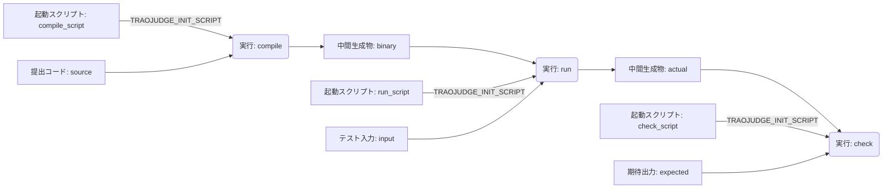

# 実行開始前のジャッジDAG定義

ジャッジ定義に含めるファイルと実行の関係を記す。既存の用語は[用語集](../../../domain/GLOSSARY.md)、登録・提出との接続は[受け渡し仕様](../01-external-interfaces/problem-registration-contract.md)を参照する。

## この定義で使う用語

**アーティファクト**:
ジャッジの処理で使う、名前を持つファイル。入力ファイルと中間生成物ファイルを含む。
_Avoid_: テストケース（入力・期待出力などのファイルと、ケース自体を区別する）

**入力ファイル**:
DAG 内の実行によって生成されず、具体的なファイルを得る方法を持つアーティファクト。テストケースの入力・期待出力と提出コードを同じ概念として扱う。

**中間生成物ファイル**:
DAG 内の実行によって生成されるアーティファクト。後続の実行の入力になり得る。

**実行ノード**:
名前を持ち、アーティファクトを入力または出力とする処理の定義。ジャッジ全体の実行や、その処理の個々の試行と区別する。

**実体化（realise）**:
入力ファイルの定義から、使用する具体的なファイルを得ること。登録済みの作問ファイルと提出ごとのコードで、その方法が異なる。

## ノードと辺

DAG のノードを、アーティファクトと実行ノードの2種類に分ける。アーティファクトには入力ファイルと中間生成物ファイルがあり、どちらもファイルを表す。アーティファクトと実行ノードは、それぞれ `name` を持つ。

`name` は問題全体で一意とし、アーティファクトと実行ノードで名前空間を分けない。別のDAGに属することだけを理由に、同じ問題内で名前を重複させることもできない。長さは1〜64文字、使用可能な文字はASCIIの英大文字・英小文字・数字・`_`・`-`とし、正規表現では `^[A-Za-z0-9_-]{1,64}$` と表す。

| 辺 | 意味 |
| --- | --- |
| アーティファクト → 実行ノード | その実行がファイルを入力として使う |
| 実行ノード → アーティファクト | その実行がファイルを生成する |

アーティファクト同士、実行ノード同士を直接結ぶ辺は持たない。この制約により、グラフはアーティファクト集合と実行ノード集合からなる二部グラフとなる。二部グラフであることだけでは閉路を排除できないため、DAG として有向閉路がないことも検証する。

入力ファイルの入次数は0、中間生成物ファイルの入次数は必ず1とする。したがって、中間生成物ファイルには生成元の実行ノードがちょうど1つ存在する。

DAG の依存関係は、上記のファイルの入力・生成だけで表す。ファイル以外の依存関係は持たず、実行順序だけを指定する依存辺も設けない。

## スキーマ上の辺の表現

二部グラフのすべての辺は実行ノードを一方の端点に持つため、辺の定義は実行ノードに集約する。各実行ノードが入力・出力のアーティファクト参照を持ち、グラフ全体の辺を表す。

| 実行ノードが持つ定義 | 復元される辺 |
| --- | --- |
| 入力アーティファクトへの参照 | 参照先アーティファクト → この実行ノード |
| 出力アーティファクトへの参照 | この実行ノード → 参照先アーティファクト |

アーティファクト側には辺の定義を持たせず、独立した辺の一覧も持たせない。中間生成物の生成元は実行ノードの出力定義から求める。参照先が存在するアーティファクトであること、入力ファイルはどの実行の出力にも含まれないこと、中間生成物ファイルはちょうど1つの生成辺を持つことを検証する。実行ノード内の参照から辺を復元し、有向閉路がないことも検証する。

`TRAOJUDGE_INIT_SCRIPT` とファイルの対応は、その実行ノードが持つ入力定義で表す。入出力定義の具体的なフィールド構成と参照の記述形式は実装で定める。

## 実行環境

1つのDAGに属する全実行ノードは、同一の実行環境を使う。実行環境はDAG全体で共通の指定として扱い、ノードごとに異なる環境を指定することはできない。環境の識別子・版・パラメータの具体的な形式は実装で定める。

## サービス予約の環境変数

`TRAOJUDGE_` で始まる環境変数名（`TRAOJUDGE_*`）はサービス側が予約する。作問側は、この接頭辞を持つ環境変数を独自の用途に使ったり、サービスが定める意味を変更したりできない。`TRAOJUDGE_INIT_SCRIPT` への入力ファイルの割り当ても、サービスが定める契約に従う。

ユーザーの提出時に確定するパラメーターは、原則として `TRAOJUDGE_*` の環境変数を通じて各実行へ渡す。具体的な変数名・値の形式・対象となるパラメーターはサービス側の実装で定める。

## 実行の起動スクリプト

すべての実行ノードは、環境変数 `TRAOJUDGE_INIT_SCRIPT` に割り当てるファイルを、必ず入力として受け取る。そのファイルを表すアーティファクトから実行ノードへの入力辺を持ち、`TRAOJUDGE_INIT_SCRIPT` の値には実行環境内での当該ファイルのパスを設定する。実行開始時には、このパスのファイルを実行する。

環境変数への割り当ては、実行ノードが受け取る入力と対応付ける。起動スクリプトも通常のファイル依存としてDAGに含めるため、追加のノード種別やファイル以外の依存辺は設けない。起動スクリプトは、実体化の情報を持つ入力ファイルでも、先行する実行が生成した中間生成物ファイルでもよい。

`TRAOJUDGE_INIT_SCRIPT` に対応する入力がない定義や、対応先がその実行ノードの入力でない定義は不正とする。入力と環境変数の対応の具体的な記述形式、ファイルの配置先、スクリプトの具体的な呼び出し方法は実装で定める。

`TRAOJUDGE_INIT_SCRIPT` が指すファイルの実行による標準出力（stdout）は、サービスが指定するスキーマを満たさなければならない。スキーマの具体的な形式・フィールドはサービス側の実装で定める。

## 入力ファイルの実体化

入力ファイルは、どのように具体的なファイルを得るかを表す `realise` 情報を持つ。テストケースの入力・期待出力と提出コードは、いずれも入力ファイルとして表現する。用途ごとに別のノード種別を設ける必要はない。

| 入力ファイルの例 | 実体化で使う情報の意味 |
| --- | --- |
| テストケースの入力・期待出力 | 使用する問題版に属する、登録済みファイルへの参照 |
| 提出コード | そのジャッジの対象となる提出のコードへの参照 |

上表は必要な情報の意味を示す。`realise` の具体的なフィールドや方式の一覧は実装で定める。

再利用するジャッジ定義では、提出コードの具体的な内容は固定しない。提出固有の入力を適用するときに対象ファイルを特定できるようにする。入力ファイルの実体化と、DAG 内の実行による中間生成物ファイルの生成を区別する。

実行開始前に中間生成物ファイルのノードが定義されていても、その内容がすでに存在することは要求しない。定義の具体化と実ファイルの転送・配置のタイミングは実装で定める。

## 例

以下の名前と処理は構造を示す例であり、予約名や必須の実行構成ではない。

`source`・`input`・`expected` は実体化の情報を持つ入力ファイル、`binary`・`actual` は実行が生成するファイルである。

この例では、`compile_script`・`run_script`・`check_script` も実体化の情報を持つ入力ファイルとする。各実行は、対応するスクリプトのパスを `TRAOJUDGE_INIT_SCRIPT` として受け取り、開始時にそのファイルを実行する。

## 実装に委ねる事項

本書に記したDAGの構造と制約を要件として確定し、以下の詳細は当面、実装依存とする。これらを要件上の未決事項や、実装着手前の追加合意が必要な事項としては扱わず、確定した要件を満たす範囲で実装時に決定する。

- ノード参照の具体的な記述方法。
- `realise` が扱う方式と、その方式ごとの情報。登録ファイル・提出コードを具体的なオブジェクト参照へ対応付ける方法。
- 実行ノード内の入出力定義の具体的なフィールド構成。入力と環境変数の対応、ファイル名・配置先を指定する場所。
- 共通の実行環境の指定形式、起動スクリプトの具体的な呼び出し方法、各実行の制限の定義。
- サービス予約の環境変数の具体的な名前・値の形式・提出時パラメーターとの対応、および起動スクリプトのstdoutにサービスが指定するスキーマ。
- 名前・辺・入次数・閉路・共通の実行環境・必須の起動スクリプト入力・予約環境変数・stdoutスキーマの制約に加えて必要な検証項目、共有する形式の版、既存の登録用ファイル一覧との対応。

ファイル内容のハッシュ形式は既存の [FileManifestEntry](../../../API/schemas/files.yaml) で定める SHA-256（小文字16進64文字）を参照する。アーティファクトの `name` と内容のハッシュは別の情報であり、中間生成物の内容のハッシュを実行開始前に要求するかどうかは本定義では定めない。
