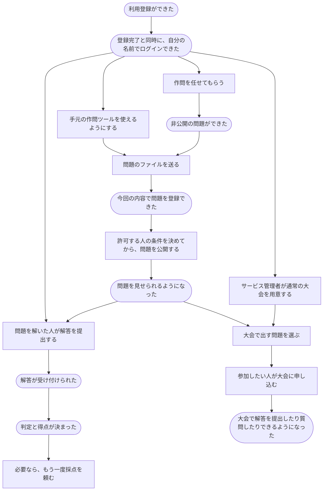

# 利用者の行動から読むシナリオ

2026-10-18。利用者が「何をしたいか」「何をすると、どうなるか」を、操作ごとの話に分けて記す。各ファイルに、始める前の条件、操作の流れ、うまくいかなかった場合、できたと言えること、まだ決めることをまとめる。

[すべての操作の許可条件](permission-operations.md)に、「誰が・誰に／何に・何をしてよいか」と、成功したときに成立する事実を列挙する。各シナリオにも対応する条件を書く。

分類は「問題投稿・提出・コンテスト・認証・権限付与／剥奪・それ以外」の6つ。話のつながりは分類をまたいでよい。以下の流れや各シナリオは、実装する範囲を相談するための初版である。

## 問題を用意して、解いてもらうまで

矢印は利用者がたどる道筋の一例。誰でもすべての操作ができるという意味ではなく、それぞれの話に書いた条件を満たして進む。

利用登録の完了時に本人のセッションを作成し、そのままログイン済みにする。問題や大会を作った人に最初からどの仕事を任せるかは、それぞれの話の中に残す。解説の投稿には、先に解答を提出することを必須としない。

## 問題投稿

| 番号 | したいこと | 何ができたら終わりか |
| --- | --- | --- |
| P1 | [新しい問題を作り、内容を直す・取り下げる](scenarios/problems/create-problem.md) | 非公開の問題を作り、許された範囲で直す・取り下げることができた |
| P2 | [手元で作った問題のファイルを登録する](scenarios/problems/upload-problem-files.md) | ファイル・設定・使うファイルの指定を確かめ、今回の内容を登録できた |
| P3 | [テストや採点の進め方を直す](scenarios/problems/edit-tests-and-judging.md) | テストや採点の進め方の変更を登録できた |

## 提出

| 番号 | したいこと | 何ができたら終わりか |
| --- | --- | --- |
| S1 | [解答を提出して採点してもらう](scenarios/submissions/submit-answer.md) | 提出が受け付けられ、どの提出の判定か分かる形で結果が決まった |
| S2 | [前の提出をもう一度採点してもらう](scenarios/submissions/judge-again.md) | 前の採点と区別できる形で、今回の採点を終えた |
| S3 | [まとめて採点し直してもらう](scenarios/submissions/judge-many-again.md) | まとめた依頼を受け付け、終えたものと終えられなかったものが分かった |
| S4 | [進み具合を見ながら結果を待つ](scenarios/submissions/watch-judging.md) | 完了したテストケース数を途中でも確認でき、不正解や時間切れでも全ケースを実行して結果が決まった |

S4では、読み取りAPIの一覧より先に、途中で何をいつ見せるかを具体化する。[表示からAPI・実行基盤へ渡す条件](submission-progress-constraints.md)を対応付ける。

## コンテスト

| 番号 | したいこと | 何ができたら終わりか |
| --- | --- | --- |
| C1 | [大会を用意し、予定やルールを決める](scenarios/contests/organize-contest.md) | 大会を作り、許された範囲で予定やルールを直せた |
| C2 | [大会で出す問題を選ぶ・外す](scenarios/contests/choose-problems.md) | 大会で出す問題の組み合わせが変わった |
| C3 | [大会について質問し、回答する](scenarios/contests/ask-and-answer.md) | 参加者の質問が残り、運営する人の回答を確認できた |

## 認証

メールで登録・ログインする話に加え、traQ・Google・GitHubの外部アカウントで登録・ログインする話と、今の利用者にログイン方法を追加・解除する話を含める。ログイン方法を増やす操作と、作問や大会運営を任せる操作はそれぞれの話で扱う。

| 番号 | したいこと | 何ができたら終わりか |
| --- | --- | --- |
| A1 | [メールで利用登録する](scenarios/authentication/register.md) | 登録が済み、基本的な機能を使う資格を得た |
| A2 | [ログインして、使い終わったらログアウトする](scenarios/authentication/sign-in-and-out.md) | ログインでき、使い終わったらログアウトできた |
| A3 | [登録したメールアドレスを変える](scenarios/authentication/change-email.md) | 新しいアドレスを確認して登録先が切り替わった |
| A4 | [手元の作問ツールを使えるようにする・使えなくする](scenarios/authentication/use-authoring-tool.md) | 作問ツールで自分の名前で操作でき、あとで停止できた |
| A5 | [外部サービスのアカウントで利用登録する](scenarios/authentication/register-with-another-service.md) | 利用登録が済み、その外部アカウントでログインできるようになった |
| A6 | [外部サービスのアカウントでログインする](scenarios/authentication/sign-in-with-another-service.md) | 以前と同じ利用者としてログインできた |
| A7 | [今の利用者に、別のログイン方法を追加する](scenarios/authentication/add-sign-in-method.md) | 新しい方法でも同じ利用者としてログインできるようになった |
| A8 | [追加していたログイン方法を外す](scenarios/authentication/remove-sign-in-method.md) | 指定した方法を外し、残した方法でログインできる状態を保った |

## 権限付与／剥奪

R1・R2は個別シナリオへの案内である。作業を切り出すときは、以下の一覧と各リンク先で、追加・取り消し、対象の役割、通常・バーチャル大会を分ける。HTTPの入口を共通化するかは別に決める。

| 番号 | したいこと | 何ができたら終わりか |
| --- | --- | --- |
| R1 | [仕事を任せる・外す（20の個別シナリオ）](scenarios/permissions/change-permissions.md) | 指定した人の、指定した範囲の役割だけが付いた・外れた |
| R2 | [公開範囲を変える（4つの個別シナリオ）](scenarios/permissions/share-content.md) | 指定した問題・解説が公開・非公開になった。許可する人が未決の操作は先に合意する |
| R3 | [公開された通常の大会に参加する](scenarios/permissions/join-contest.md) | 基本的な利用資格を持つ本人が、その大会の参加者になった |
| R4 | [好きな時間に挑戦する大会に参加する](scenarios/permissions/join-virtual-contest.md) | 許可する条件を合意した後、本人がその大会の参加者になった |

### R1：任せる仕事ごとに選ぶ

すべて登録済みの人が対象。問題・大会・解説の役割は、選んだ対象1つに限る。サービス管理者を任命・解任する方法は未決。

| 番号 | 任せる仕事 | 追加する話 | 外す話 |
| --- | --- | --- | --- |
| R1-01 | 作問する資格 | [誰が任せてよいか](scenarios/permissions/grant-writer.md) | [誰が外してよいか](scenarios/permissions/revoke-writer.md) |
| R1-02 | 問題の管理担当 | [誰が任せてよいか](scenarios/permissions/grant-problem-owner.md) | [誰が外してよいか](scenarios/permissions/revoke-problem-owner.md) |
| R1-03 | 問題のテスト担当 | [誰が任せてよいか](scenarios/permissions/grant-tester.md) | [誰が外してよいか](scenarios/permissions/revoke-tester.md) |
| R1-04 | 通常の大会の責任者 | [誰が任せてよいか](scenarios/permissions/grant-contest-admin.md) | [誰が外してよいか](scenarios/permissions/revoke-contest-admin.md) |
| R1-05 | 通常の大会の運営担当 | [誰が任せてよいか](scenarios/permissions/grant-contest-setter.md) | [誰が外してよいか](scenarios/permissions/revoke-contest-setter.md) |
| R1-06 | 好きな時間に挑戦する大会の運営担当 | [誰が任せてよいか](scenarios/permissions/grant-virtual-contest-setter.md) | [誰が外してよいか](scenarios/permissions/revoke-virtual-contest-setter.md) |
| R1-07 | 基本的な利用資格 | [誰が任せてよいか](scenarios/permissions/grant-standard-user.md) | [誰が外してよいか](scenarios/permissions/revoke-standard-user.md) |
| R1-08 | 解説の編集担当 | [誰が任せてよいか](scenarios/permissions/grant-editorial-author.md) | [誰が外してよいか](scenarios/permissions/revoke-editorial-author.md) |
| R1-09 | 通常の大会の参加資格 | [誰が任せてよいか](scenarios/permissions/grant-contestant.md) | [誰が外してよいか](scenarios/permissions/revoke-contestant.md) |
| R1-10 | 好きな時間に挑戦する大会の参加資格 | [誰が任せてよいか](scenarios/permissions/grant-virtual-contestant.md) | [誰が外してよいか](scenarios/permissions/revoke-virtual-contestant.md) |

### R2：対象と、変える向きごとに選ぶ

| 番号 | 操作ごとの話 | 誰がしてよいか |
| --- | --- | --- |
| R2-01 | [問題を公開する](scenarios/permissions/publish-problem.md) | 未決 |
| R2-02 | [問題を非公開にする](scenarios/permissions/hide-problem.md) | サービス管理者はすべての問題が対象。他の役割は未決 |
| R2-03 | [解説を公開する](scenarios/permissions/publish-editorial.md) | 未決 |
| R2-04 | [解説を非公開にする](scenarios/permissions/hide-editorial.md) | 未決 |

## それ以外

| 番号 | したいこと | 何ができたら終わりか |
| --- | --- | --- |
| O1 | [解説を書き、直す・取り下げる](scenarios/others/write-editorial.md) | 解説を投稿し、許された範囲で直す・取り下げることができた |
| O2 | [プロフィールを書き直す](scenarios/others/edit-profile.md) | 自分のプロフィールを書き換えられた |
| O3 | [他の利用者のプロフィールと作成した問題を見る](scenarios/others/view-user-profile.md) | 公開プロフィールと、その利用者が作成した公開問題を閲覧できた |

## 分担するときにそろえること

各ファイルをもとに、担当する人、最初に用意する人や問題の例、受け取る情報、相手に渡す結果をそろえる。ほかの担当の作業が終わる前でも、同じ例を使って自分の担当部分を確かめられるようにする。

たとえば「問題を編集できる人」「公開された問題」「開催中で参加済みの大会」を共通の例として使う。まだ決まっていない点は、できたことにせず各ファイルに残す。

## 実装に対応付ける資料

- [入力・識別子・単独確認・未決事項のメモ](scenario-implementation-notes.md)
- [提出の途中表示と、基盤に必要な条件](submission-progress-constraints.md)
- [作業全体の棚卸し](poc-work-breakdown.md)
- [AWS側の構成](../services/aws-building-blocks.md)
- [操作ごとの許可条件・成立する事実](permission-operations.md)
- [役割の定義と根拠](../domain/role.md)
