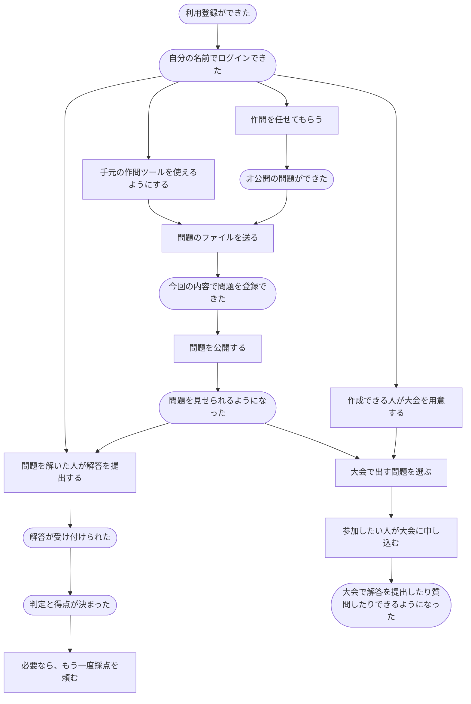

# 利用者の行動から読むシナリオ

2026-10-18。利用者が「何をしたいか」「何をすると、どうなるか」を、22本の話に分けて記す。各ファイルに、始める前の条件、操作の流れ、うまくいかなかった場合、できたと言えること、まだ決めることをまとめる。

分類は「問題投稿・提出・コンテスト・認証・権限付与／剥奪・それ以外」の6つ。話のつながりは分類をまたいでよい。以下の流れや各シナリオは、実装する範囲を相談するための初版である。

## 問題を用意して、解いてもらうまで

矢印は利用者がたどる道筋の一例。誰でもすべての操作ができるという意味ではなく、それぞれの話に書いた条件を満たして進む。

登録した直後に、そのままログインした扱いにするかはまだ決めていない。問題や大会を作った人に最初からどの仕事を任せるかも、それぞれの話の中に残す。解説の投稿には、先に解答を提出することを必須としない。

## 問題投稿

| 番号 | したいこと | 何ができたら終わりか |
| --- | --- | --- |
| P1 | [新しい問題を作り、内容を直す・取り下げる](scenarios/problems/create-problem.md) | 非公開の問題を作り、許された範囲で直す・取り下げることができた |
| P2 | [手元で作った問題のファイルを登録する](scenarios/problems/upload-problem-files.md) | ファイル・設定・使うファイルの指定を確かめ、今回の内容を登録できた |
| P3 | [テストや採点の進め方を直す](scenarios/problems/edit-tests-and-judging.md) | テストや採点の進め方の変更を登録できた |

## 提出

| 番号 | したいこと | 何ができたら終わりか |
| --- | --- | --- |
| S1 | [解答を提出して採点してもらう](scenarios/submissions/submit-answer.md) | 提出が受け付けられ、どの提出の判定か分かる形で結果が決まった |
| S2 | [前の提出をもう一度採点してもらう](scenarios/submissions/judge-again.md) | 前の採点と区別できる形で、今回の採点を終えた |
| S3 | [まとめて採点し直してもらう](scenarios/submissions/judge-many-again.md) | まとめた依頼を受け付け、終えたものと終えられなかったものが分かった |

## コンテスト

| 番号 | したいこと | 何ができたら終わりか |
| --- | --- | --- |
| C1 | [大会を用意し、予定やルールを決める](scenarios/contests/organize-contest.md) | 大会を作り、許された範囲で予定やルールを直せた |
| C2 | [大会で出す問題を選ぶ・外す](scenarios/contests/choose-problems.md) | 大会で出す問題の組み合わせが変わった |
| C3 | [大会について質問し、回答する](scenarios/contests/ask-and-answer.md) | 参加者の質問が残り、運営する人の回答を確認できた |

## 認証

メールで登録・ログインする話に加え、外部サービスのアカウントで登録・ログインする話と、今の利用者にログイン方法を追加・解除する話を含める。候補はGoogle・GitHub・traQ。どれを提供するかはまだ決めていない。ログイン方法を増やす操作と、作問や大会運営を任せる操作はそれぞれの話で扱う。

| 番号 | したいこと | 何ができたら終わりか |
| --- | --- | --- |
| A1 | [メールで利用登録する](scenarios/authentication/register.md) | 登録が済み、基本的な機能を使う資格を得た |
| A2 | [ログインして、使い終わったらログアウトする](scenarios/authentication/sign-in-and-out.md) | ログインでき、使い終わったらログアウトできた |
| A3 | [登録したメールアドレスを変える](scenarios/authentication/change-email.md) | 新しいアドレスを確認して登録先が切り替わった |
| A4 | [手元の作問ツールを使えるようにする・使えなくする](scenarios/authentication/use-authoring-tool.md) | 作問ツールで自分の名前で操作でき、あとで停止できた |
| A5 | [外部サービスのアカウントで利用登録する](scenarios/authentication/register-with-another-service.md) | 利用登録が済み、その外部アカウントでログインできるようになった |
| A6 | [外部サービスのアカウントでログインする](scenarios/authentication/sign-in-with-another-service.md) | 以前と同じ利用者としてログインできた |
| A7 | [今の利用者に、別のログイン方法を追加する](scenarios/authentication/add-sign-in-method.md) | 新しい方法でも同じ利用者としてログインできるようになった |
| A8 | [追加していたログイン方法を外す](scenarios/authentication/remove-sign-in-method.md) | 指定した方法を外し、残した方法でログインできる状態を保った |

## 権限付与／剥奪

| 番号 | したいこと | 何ができたら終わりか |
| --- | --- | --- |
| R1 | [できることを増やす・減らす](scenarios/permissions/change-permissions.md) | 対象の人に任せる仕事の範囲が変わった |
| R2 | [問題や解説を見せる相手を変える](scenarios/permissions/share-content.md) | 問題や解説を見せる範囲が変わった |
| R3 | [大会に参加する](scenarios/permissions/join-contest.md) | 参加が受け付けられ、その大会で解答や質問ができる |

## それ以外

| 番号 | したいこと | 何ができたら終わりか |
| --- | --- | --- |
| O1 | [解説を書き、直す・取り下げる](scenarios/others/write-editorial.md) | 解説を投稿し、許された範囲で直す・取り下げることができた |
| O2 | [プロフィールを書き直す](scenarios/others/edit-profile.md) | 自分のプロフィールを書き換えられた |

## 分担するときにそろえること

各ファイルをもとに、担当する人、最初に用意する人や問題の例、受け取る情報、相手に渡す結果をそろえる。ほかの担当の作業が終わる前でも、同じ例を使って自分の担当部分を確かめられるようにする。

たとえば「問題を編集できる人」「公開された問題」「開催中で参加済みの大会」を共通の例として使う。まだ決まっていない点は、できたことにせず各ファイルに残す。

## 実装に対応付ける資料

- [入力・識別子・単独確認・未決事項のメモ](scenario-implementation-notes.md)
- [作業全体の棚卸し](poc-work-breakdown.md)
- [AWS側の構成](../services/aws-building-blocks.md)
- [誰にどの操作が許されるか](../domain/role.md)
