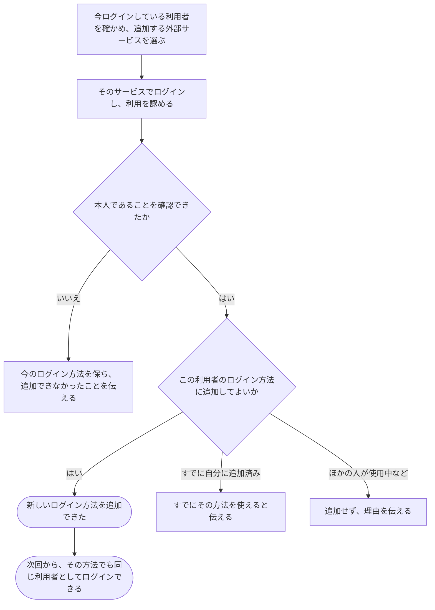

# 今の利用者に、別のログイン方法を追加する

[シナリオの一覧へ](../../mutation-scenarios.md)

## したいこと

利用者が、今使っている自分の利用登録に、外部サービスのアカウントを追加する。次回からは、そのアカウントでも同じ利用者としてログインできるようにする。

## 誰が、誰に、何をしてよいか

| 操作 | 誰が | 誰に／何に・範囲 |
| --- | --- | --- |
| ログイン方法を追加する（A7-01） | ログイン中で、追加する外部アカウントでも本人確認できた本人 | 自分のログイン方法。ほかの利用者に結び付いた方法は使わない |

本人に対する操作だけを扱う。サービス管理者という理由だけで、他の人の認証手段やプロフィールを変更することはできない。全操作の対応は[許可条件の一覧](../../permission-operations.md)を参照する。

## 始める前

自分の名前でログインしていること。追加したい外部アカウントを自分が使えること。候補は Google・GitHub・traQ であり、どれを提供するかはまだ決めていない。

## 流れ

## できたと言えること

- 外部アカウントを使える本人だと確認してから、今の利用者に追加する。
- ほかの利用者が使っている外部アカウントを、勝手に付け替えない。
- 追加後も、以前のログイン方法や提出・大会の記録を引き継ぐ。
- ログイン方法を増やしただけで、作問や大会運営を新たに任せたことにはしない。

## まだ決めること

- Google・GitHub・traQ のうち、どれを提供するか。
- 同じ外部サービスの別アカウントを複数追加できるか。
- 追加する前に、今の利用者本人だともう一度確かめる必要があるか。

## つながる話

- [外部サービスのアカウントでログインする](sign-in-with-another-service.md)
- [追加していたログイン方法を外す](remove-sign-in-method.md)
- [できることを増やす・減らす](../permissions/change-permissions.md)
