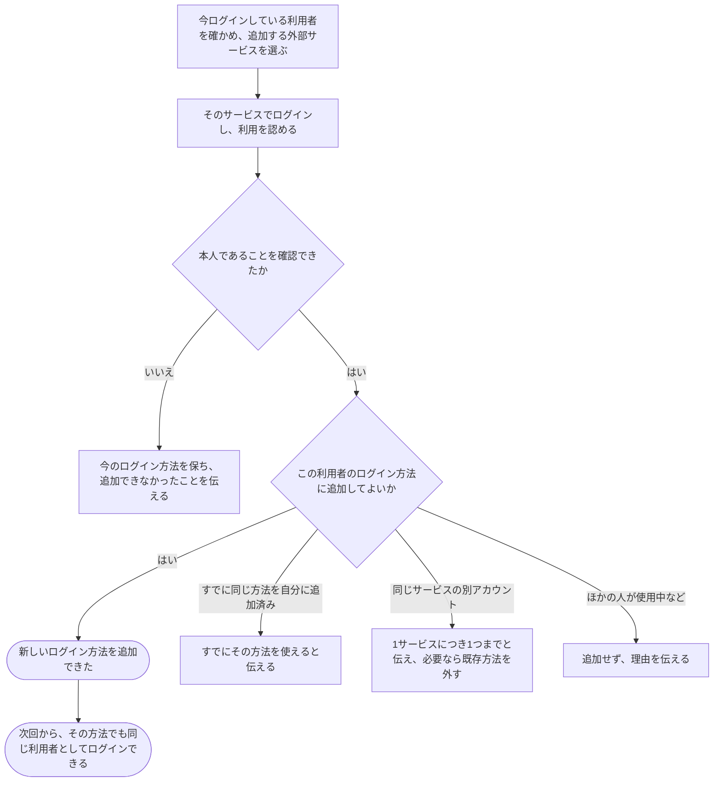

# 今の利用者に、別のログイン方法を追加する

[シナリオの一覧へ](../../mutation-scenarios.md)

## したいこと

利用者が、今使っている自分の利用登録に、外部サービスのアカウントを追加する。次回からは、そのアカウントでも同じ利用者としてログインできるようにする。

## 誰が、誰に、何をしてよいか

| 操作 | 誰が | 誰に／何に・範囲 |
| --- | --- | --- |
| ログイン方法を追加する（A7-01） | ログイン中で、追加する外部アカウントでも本人確認できた本人 | 自分のログイン方法。ほかの利用者に結び付いた方法は使わない |

本人に対する操作だけを扱う。サービス管理者という理由だけで、他の人の認証手段やプロフィールを変更することはできない。全操作の対応は[許可条件の一覧](../../permission-operations.md)を参照する。

## 始める前

自分の名前でログインしていること。追加したい外部アカウントを自分が使えること。外部認証先は traQ・Google・GitHub の3つ。

## 流れ

## APIの呼び出し順

現在のセッションCookieと許可したWebUIのOriginを使う。追加する本人は外部サービスで確認するが、現在の利用者に対する追加の再認証は求めない。
同じ外部サービスのアカウントは、1人の利用者につき1つまで登録できる。別のアカウントに替える場合は、既存の方法を先に外す（最後のWebログイン方法を外すことはできない）。

1. 画面に現在のログイン方法を表示するため、Cookie付きで `GET /api/v1/me/sign-in-methods` を呼ぶ。`200 OK` で本人のログイン方法一覧が返る。

2. 追加する外部サービスを選ぶ。手順1の一覧に同じ `kind` がある場合は、追加要求を送らず「すでに登録済み」と案内する。サーバーも二重登録を防ぐため、`POST /api/v1/me/sign-in-methods/external-authorizations` で同じサービスが登録済みなら `409 Conflict` を返す。

   一覧にない場合は、追加要求を送る。

   `201 Created` で、本人確認に使う `authorizationId`・`authorizationUrl`・`expiresAt` が返る。この操作は開始時のログイン中の利用者に結び付く。

3. WebUIが `authorizationUrl` を開く。本人確認に成功したら、戻った認可情報を同じ利用者のセッションCookie付きで `POST /api/v1/me/sign-in-methods/external-authorizations/{authorizationId}/complete` に送る。

   新しいログイン方法が追加されると `201 Created` でその情報が返る。本人の利用者ID・権限・既存の記録は変わらず、セッションも維持される。すでに同じ本人に追加済みなら新しい行は作らず、既存の方法を `200 OK` で返して「すでに使える」と案内する。

   同じ外部identityがすでに本人に追加済みなら既存の方法を `200 OK` で返す。同じサービスの別アカウントを追加しようとした場合や、外部identityがほかの利用者に結び付いている場合は `409 Conflict` とし、登録済みの方法を置き換えない。追加先の本人確認に失敗・中断した場合や外部サービスから応答を得られない場合も、ログイン方法は追加しない。現在のセッションは維持する。

## できたと言えること

- 外部アカウントを使える本人だと確認してから、今の利用者に追加する。
- ほかの利用者が使っている外部アカウントを、勝手に付け替えない。
- 追加後も、以前のログイン方法や提出・大会の記録を引き継ぐ。
- ログイン方法を増やしただけで、作問や大会運営を新たに任せたことにはしない。

## まだ決めること

- なし。

## つながる話

- [外部サービスのアカウントでログインする](sign-in-with-another-service.md)
- [追加していたログイン方法を外す](remove-sign-in-method.md)
- [できることを増やす・減らす](../permissions/change-permissions.md)
