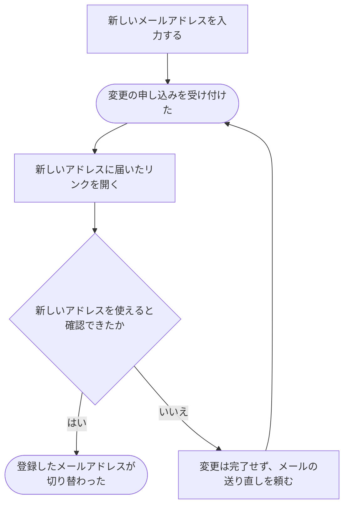

# 登録したメールアドレスを変える

[シナリオの一覧へ](../../mutation-scenarios.md)

## したいこと

利用者が、今後のログインなどに使うメールアドレスを変更する。新しいアドレスでメールを受け取れることを確かめてから切り替える。

## 誰が、誰に、何をしてよいか

| 操作 | 誰が | 誰に／何に・範囲 |
| --- | --- | --- |
| 新しいメールアドレスの確認を頼む（A3-01） | ログインしている本人 | 自分の登録先メール |
| 新しいメールを確認し、変更を完了する（A3-02） | 新しいメールを確認した本人。開始した利用者との一致が必要 | 自分の登録先メール |

本人に対する操作だけを扱う。サービス管理者という理由だけで、他の人の認証手段やプロフィールを変更することはできない。全操作の対応は[許可条件の一覧](../../permission-operations.md)を参照する。

## 始める前

自分の名前でログインしていること。新しいアドレスでメールを受け取れること。

## 流れ

## できたと言えること

- 新しいアドレスを確認できてから、登録先が切り替わる。
- 確認を終える前に、以前のアドレスが勝手に置き換わらない。
- 変更できなかったときに、完了したように案内しない。

## まだ決めること

- 以前のアドレスへのお知らせや、変更途中のログインをどう扱うか。
- ほかの人が登録済みのアドレスが指定された場合の案内と、確認リンクの期限。

## つながる話

- [ログインして、使い終わったらログアウトする](sign-in-and-out.md)
- [プロフィールを書き直す](../others/edit-profile.md)
