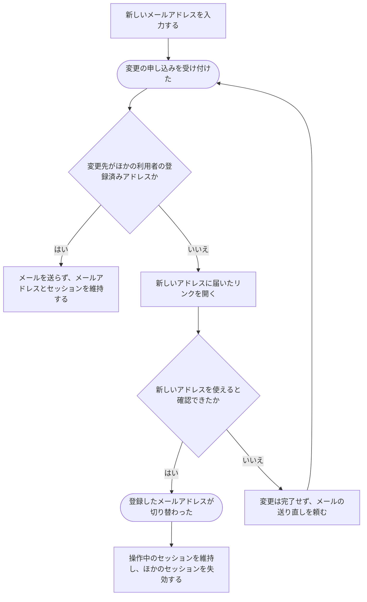

# 登録したメールアドレスを変える

[シナリオの一覧へ](../../mutation-scenarios.md)

## したいこと

利用者が、今後のログインなどに使うメールアドレスを変更する。新しいアドレスでメールを受け取れることを確かめてから切り替える。

## 誰が、誰に、何をしてよいか

| 操作 | 誰が | 誰に／何に・範囲 |
| --- | --- | --- |
| 新しいメールアドレスの確認を頼む（A3-01） | ログインしている本人 | 自分の登録先メール |
| 新しいメールを確認し、変更を完了する（A3-02） | 新しいメールを確認した本人。開始した利用者との一致が必要 | 自分の登録先メール |

本人に対する操作だけを扱う。サービス管理者という理由だけで、他の人の認証手段やプロフィールを変更することはできない。全操作の対応は[許可条件の一覧](../../permission-operations.md)を参照する。

## 始める前

自分の名前でログインしていること。新しいアドレスでメールを受け取れること。

## 流れ

## APIの呼び出し順

どちらのAPIも、ログイン中のセッションCookieと、許可したWebUIのOriginが必要。

1. `POST /api/v1/me/email-changes` で新しいメールアドレスへの確認メールを依頼する。

   応答は `202 Accepted`。登録先はまだ切り替わらない。変更先がほかの利用者の登録済みアドレスでも同じ応答を返すが、この場合は確認メールを送らず、確認用トークンも発行しない。

2. 新しいアドレスに届いたリンクを開き、変更を申し込んだ本人として `POST /api/v1/me/email-changes/complete` に確認用トークンを送る。

   変更完了の応答は `204 No Content`。応答本文は返さない。操作中のセッションを維持し、それ以外の本人の既存のセッションを失効する。現在のセッションCookieを `Set-Cookie` の `Max-Age=7776000`（90日）で更新する。WebUIはログイン状態のまま変更完了を表示する。

以前のメールアドレスへの変更完了通知は送らない。

## 変更先がほかの利用者の登録済みアドレスの場合

- 変更依頼では登録の有無によらず `202 Accepted` と同じ形式の `requestId`・`acceptedAt` を返す。登録済みを理由に `409` を返したり、送信したかどうかを応答本文・ヘッダーに含めたりしない。
- 確認メールを送信せず、確認用トークンも発行しない。既存のメールアドレスやセッションを変更しない。
- WebUIの受付表示も登録状況やメール送信の有無を示さず、メールの送信完了を断定しない。

## 変更前後のログイン状態

- 確認が完了するまでは、メール変更の申し込みだけを理由にセッションを失効させない。
- メールアドレスの切り替えと同時に、変更完了APIのセッションCookieで特定される現在のセッションを除き、本人の既存のセッションをサーバー側で失効する。維持するセッションを要求本文などで指定することはできない。
- 操作中のブラウザでは再ログインを求めない。同じCookieを共有するタブもログイン状態を維持する。「操作中の端末」はこのセッション単位で扱い、同じ端末でも別のセッションを使うブラウザは失効対象になる。
- 現在のセッションは通常のアクセスと同じく、その時点から90日後まで延長し、Cookieも同じDomain・Pathで更新する。
- 他のセッションのCookieが端末に残っていても認証には使えず、認証必須APIへの次回アクセスは `401` となり、再ログインが必要になる。通常のアクセスによる期限延長で失効したセッションを復活させない。
- トークンの期限切れなどで変更が成立しなかった場合は、変更不成立を理由に既存のセッションを失効させない。

## 確認リンクの有効期限

- 確認用トークンは、変更を申し込んだ利用者・新しいメールアドレス・メール変更目的に紐付ける。
- 発行から30分間有効とし、30分が経過した時点で使えなくなる。リンクを開いても期限は延長しない。
- リンクを開くGETだけでは消費せず、本人が `POST /api/v1/me/email-changes/complete` で変更を完了したときに一度だけ消費する。
- 期限切れ・使用済み・不正なトークンでは登録先を変更しない。確認メールの再送には `POST /api/v1/me/email-changes` を使う。
- たとえば13:00発行なら13:30に失効する。13:10にリンクを開いても失効は13:30のままで、13:15に変更が完了した場合は以降の再利用を認めない。

## できたと言えること

- 新しいアドレスを確認できてから、登録先が切り替わる。
- 確認を終える前に、以前のアドレスが勝手に置き換わらない。
- 変更できなかったときに、完了したように案内しない。
- 変更完了後も操作中のセッションは利用でき、それ以外の既存のセッションでは再ログインが必要になる。

## つながる話

- [ログインして、使い終わったらログアウトする](sign-in-and-out.md)
- [プロフィールを書き直す](../others/edit-profile.md)
