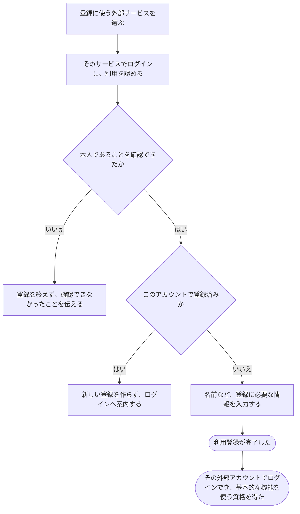

# 外部サービスのアカウントで利用登録する

[シナリオの一覧へ](../../mutation-scenarios.md)

## したいこと

初めて使う人が、すでに持っている外部サービスのアカウントを使って利用登録する。本人であることを確認できたら、登録を終え、問題を解くなどの基本的な機能を使えるようになる。

## 始める前

利用できる外部サービスのアカウントを持ち、そのアカウントでログインできること。候補は Google・GitHub・traQ であり、どれを提供するかはまだ決めていない。

## 流れ

## できたと言えること

- 本人であることを確認できてから、利用登録を完了する。
- 登録済みの同じ外部アカウントで、利用者を重ねて作らない。
- 登録が完了した人は、メールで登録した人と同じ基本的な機能を使う資格を得る。
- 外部サービスが伝えたメールアドレスが同じという理由だけで、ほかの利用登録へ勝手につなげない。

## まだ決めること

- Google・GitHub・traQ のうち、どれを提供するか。
- 外部サービスからメールアドレスを受け取れない場合に、追加でメール登録を求めるか。
- 登録を終えたときに、そのままログイン済みにするか。

## つながる話

- [外部サービスのアカウントでログインする](sign-in-with-another-service.md)
- [今の利用者に、別のログイン方法を追加する](add-sign-in-method.md)
- [メールで利用登録する](register.md)
