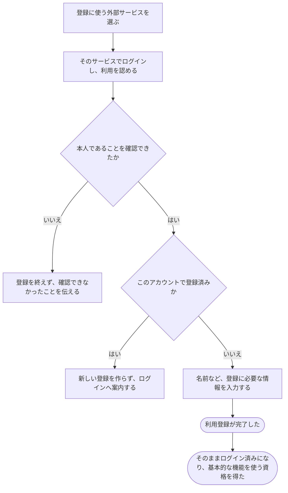

# 外部サービスのアカウントで利用登録する

[シナリオの一覧へ](../../mutation-scenarios.md)

## したいこと

初めて使う人が、すでに持っている外部サービスのアカウントを使って利用登録する。本人であることを確認できたら、登録を終え、問題を解くなどの基本的な機能を使えるようになる。

## 誰が、誰に、何をしてよいか

| 操作 | 誰が | 誰に／何に・範囲 |
| --- | --- | --- |
| 外部アカウントで利用登録する（A5-01） | 未登録で、外部サービスで本人確認ができた本人 | 新規の自分の利用登録 |

本人に対する操作だけを扱う。サービス管理者という理由だけで、他の人の認証手段やプロフィールを変更することはできない。全操作の対応は[許可条件の一覧](../../permission-operations.md)を参照する。

## 始める前

利用できる外部サービスのアカウントを持ち、そのアカウントでログインできること。外部認証先は traQ・Google・GitHub の3つ。

## 流れ

## APIの呼び出し順

WebUIとAPIは同一オリジンで、ブラウザのOriginを検証する。外部サービスが返すメールアドレスは必須にしない。本人の識別には、選んだ外部サービスと、そのサービス内で変わらないアカウントIDの組み合わせを使う。

1. WebUIで外部サービスを選び、`POST /api/v1/auth/external/registrations` に開始要求を送る。

   `201 Created` で、外部サービスへ移動するURLと、この認証操作を示すID、有効期限を受け取る。応答は `Cache-Control: no-store` とする。

2. WebUIが `authorizationUrl` を開く。本人確認に成功したら、表示名と外部サービスから戻った認可情報を `POST /api/v1/auth/external/registrations/{authorizationId}/complete` に送る。

   APIは認可コードを外部サービスに照会し、開始時の外部サービス・目的・ブラウザ・有効期限との対応を検証する。未登録の外部アカウントなら、外部アカウントIDと入力された表示名で利用者を作り、`201 Created` と利用者情報を返してセッションCookieを発行する。

   同じ外部アカウントがすでに登録済みなら、新しい利用者を作らず `409 Conflict` とし、A6のログインへ案内する。メールアドレスが取得できなくても、この2段階で登録できる。メールアドレスが取得できた場合も、それだけを根拠に既存アカウントと結び付けない。

## できたと言えること

- 本人であることを確認できてから、利用登録を完了する。
- 登録済みの同じ外部アカウントで、利用者を重ねて作らない。
- 登録が完了した人は、メールで登録した人と同じ基本的な機能を使う資格を得る。
- 登録完了時に本人のセッションが作成され、そのままログイン済みになる。
- 外部サービスが伝えたメールアドレスが同じという理由だけで、ほかの利用登録へ勝手につなげない。

## つながる話

- [外部サービスのアカウントでログインする](sign-in-with-another-service.md)
- [今の利用者に、別のログイン方法を追加する](add-sign-in-method.md)
- [メールで利用登録する](register.md)
