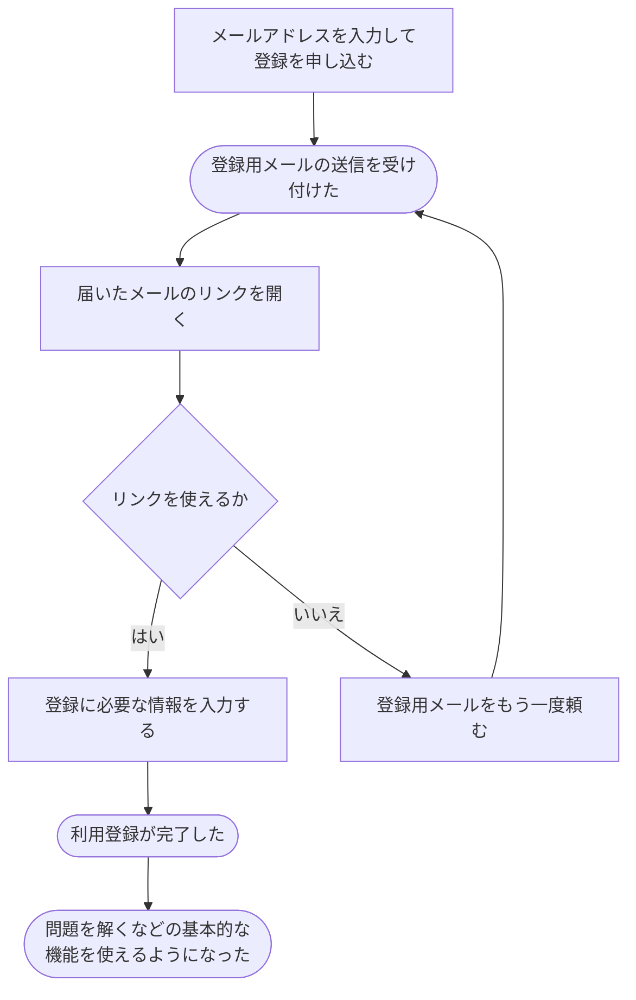

# メールで利用登録する

[シナリオの一覧へ](../../mutation-scenarios.md)

## したいこと

初めて使う人が、自分のメールアドレスで登録する。管理者に承認を頼まずに登録を終え、問題を解くなどの基本的な機能を使えるようになる。

## 誰が、誰に、何をしてよいか

| 操作 | 誰が | 誰に／何に・範囲 |
| --- | --- | --- |
| メールで利用登録を申し込む（A1-01） | 未登録で、そのメールを受け取れる本人 | 新規の自分の利用登録 |
| メールのリンクで登録を完了する（A1-02） | 有効な登録用リンクでメールを確認した本人 | 自分の利用登録 |

本人に対する操作だけを扱う。サービス管理者という理由だけで、他の人の認証手段やプロフィールを変更することはできない。全操作の対応は[許可条件の一覧](../../permission-operations.md)を参照する。

## 始める前

受け取ったメールを確認できること。登録に必要な名前などの情報を用意する。

## 流れ

## できたと言えること

- 登録を申し込んだことと、登録を終えたことが区別できる。
- 登録が完了した人は、管理者の承認を待たずに基本的な機能を使う資格を得る。
- メールが届かないときやリンクを使えないときは、送り直しを頼める。

## まだ決めること

- 登録を終えたときに、そのままログイン済みにするか。
- リンクをいつまで使えるようにするか、登録済みのメールアドレスが入力されたときにどう案内するか。

## つながる話

- [外部サービスのアカウントで利用登録する](register-with-another-service.md)
- [ログインして、使い終わったらログアウトする](sign-in-and-out.md)
- [今の利用者に、別のログイン方法を追加する](add-sign-in-method.md)
- [できることを増やす・減らす](../permissions/change-permissions.md)
