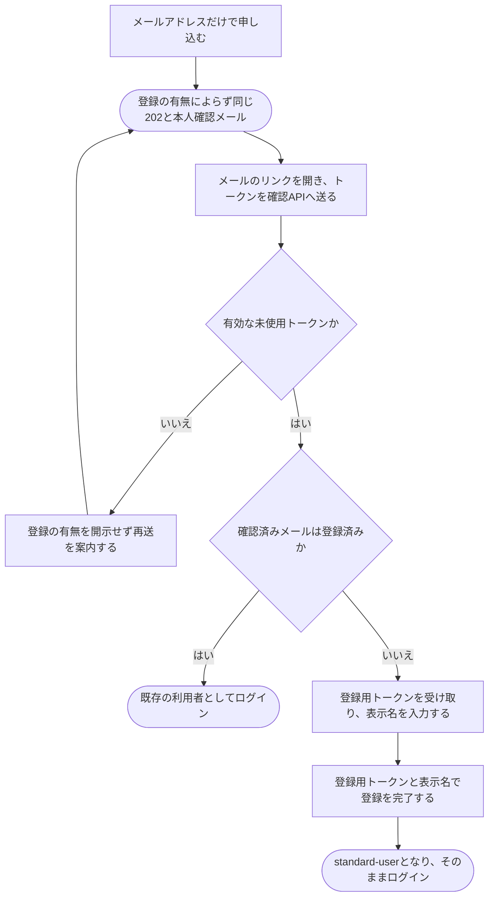

# メールで利用登録する

[シナリオの一覧へ](../../mutation-scenarios.md)

## したいこと

初めて使う人が、自分のメールアドレスで登録する。管理者に承認を頼まずに登録を終え、問題を解くなどの基本的な機能を使えるようになる。

## 誰が、誰に、何をしてよいか

| 操作 | 誰が | 誰に／何に・範囲 |
| --- | --- | --- |
| メールで利用登録を申し込む（A1-01） | そのメールを受け取れる本人 | 自分のメールの本人確認 |
| メールを確認する（A1-02） | 有効な本人確認トークンを持つ本人 | 自分のメールの確認と登録・ログインへの分岐 |
| 登録を完了する（A1-03） | メール確認後に発行された有効な登録用トークンを持つ本人 | 自分の利用登録 |

本人に対する操作だけを扱う。サービス管理者という理由だけで、他の人の認証手段やプロフィールを変更することはできない。全操作の対応は[許可条件の一覧](../../permission-operations.md)を参照する。

## 始める前

受け取ったメールを確認できること。申し込み時はメールアドレスだけを入力し、表示名はメールのリンクを開いた後に入力する。

## 流れ

## APIの呼び出し

[共通のメール認証フロー](../../../API/email-authentication.md)に従う。登録の有無はメール本文でも明かさず、メール確認後のAPI応答で初めて分岐する。

| 順番 | API | 送る情報 | 成功時の応答 |
| --- | --- | --- | --- |
| 1 | `POST /api/v1/auth/email/registrations` | メールアドレス | 登録の有無によらず202：`requestId`・`acceptedAt` |
| 2 | `POST /api/v1/auth/email/verifications` | 本人確認トークン | 200：登録済みならログイン状態、未登録なら `registrationToken` とその `expiresAt` |
| 3 | `POST /api/v1/auth/email/registrations/complete` | 登録用トークン・表示名 | 未登録の場合だけ実行。201：新しい `userId` とセッションCookie |

メール本人確認トークンの有効期限は発行から30分で、一度だけ使用できる。リンクのGETだけでは消費しない。メール確認後に発行する登録用トークンは、元の有効期限を引き継ぐ。登録済みなら2でCookieを発行してログインし、未登録なら3の登録完了時にCookieを発行してログインする。

## できたと言えること

- 登録を申し込んだことと、登録を終えたことが区別できる。
- 表示名はメール本人確認後、未登録の場合だけ入力し、登録用トークンと一緒に送信する。
- 登録が完了した人は、管理者の承認を待たずに基本的な機能を使う資格を得る。
- 登録完了時に本人のセッションが作成され、そのままログイン済みになる。
- 元のメール本人確認トークン発行から30分が経過した場合、本人確認や新規登録を完了できない。
- メールが届かないときやリンクを使えないときは、送り直しを頼める。
- APIの受付応答とメールでは登録の有無を開示せず、メール確認後にだけログインまたは新規登録へ分岐する。登録済みなら既存の利用者としてログインし、利用者を重複作成したり既存情報を上書きしたりしない。

## つながる話

- [外部サービスのアカウントで利用登録する](register-with-another-service.md)
- [ログインして、使い終わったらログアウトする](sign-in-and-out.md)
- [今の利用者に、別のログイン方法を追加する](add-sign-in-method.md)
- [できることを増やす・減らす](../permissions/change-permissions.md)
