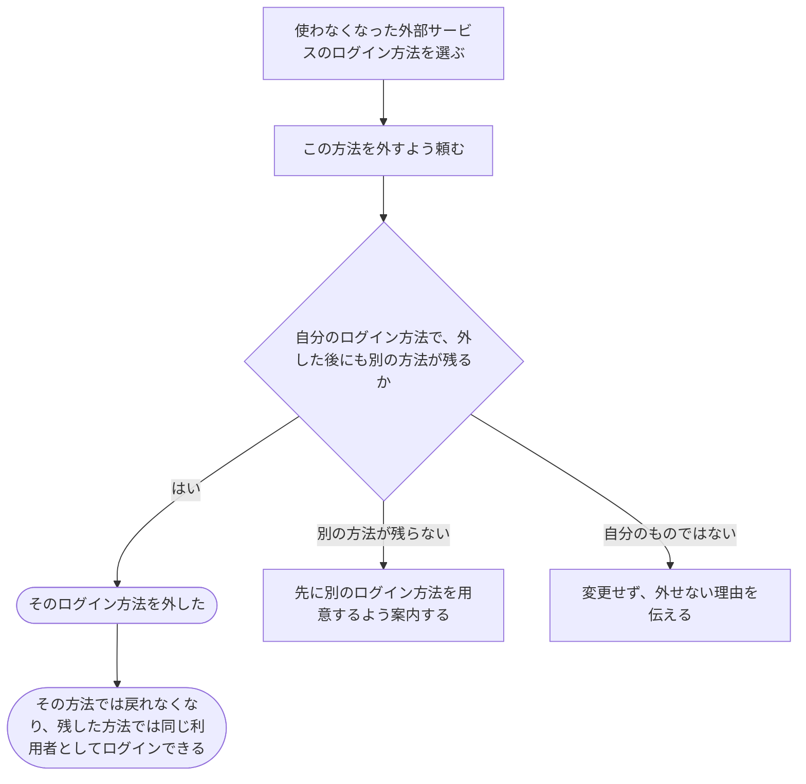

# 追加していたログイン方法を外す

[シナリオの一覧へ](../../mutation-scenarios.md)

## したいこと

利用者が、使わなくなった外部サービスのアカウントを、自分のログイン方法から外す。今後も別の方法で自分の利用登録へ戻ってこられるようにする。

## 誰が、誰に、何をしてよいか

| 操作 | 誰が | 誰に／何に・範囲 |
| --- | --- | --- |
| ログイン方法を外す（A8-01） | ログインしている本人 | 自分のログイン方法。最後のWebログイン方法は外さない |

本人に対する操作だけを扱う。サービス管理者という理由だけで、他の人の認証手段やプロフィールを変更することはできない。全操作の対応は[許可条件の一覧](../../permission-operations.md)を参照する。

## 始める前

自分の名前でログインしていること。外したいログイン方法を自分に追加してあること。外した後にも、画面へログインするための別の方法が残ること。

## 流れ

## できたと言えること

- 指定した自分のログイン方法だけを外す。
- 最後のログイン方法を外して、利用者が戻ってこられなくなることを防ぐ。
- 作問ツール専用の認証情報を、画面へログインするための別の方法として数えない。
- 外した後も、利用者の提出・大会の記録や任されている仕事を保つ。

## まだ決めること

- どの外部サービスのログイン方法を外せるようにするか。
- 外す前に、残した方法で本当にログインできるかを確かめてもらうか。
- 外した方法でログインしている端末を、その場でログアウトさせるか。

## つながる話

- [今の利用者に、別のログイン方法を追加する](add-sign-in-method.md)
- [外部サービスのアカウントでログインする](sign-in-with-another-service.md)
- [メールでログインする](sign-in-and-out.md)
- [手元の作問ツールを使えるようにする・使えなくする](use-authoring-tool.md)
