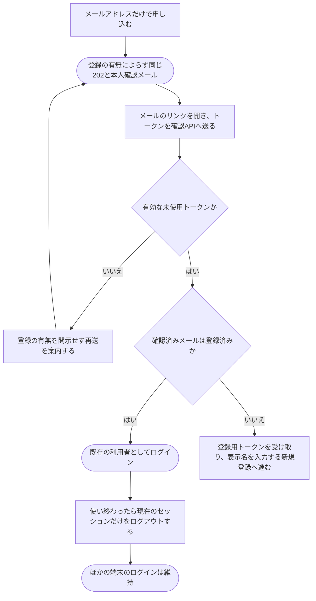

# ログインして、使い終わったらログアウトする

[シナリオの一覧へ](../../mutation-scenarios.md)

## したいこと

登録した人がメールのリンクを使ってログインする。使い終えたらログアウトし、その画面から自分の名前で操作できないようにする。

## 誰が、誰に、何をしてよいか

| 操作 | 誰が | 誰に／何に・範囲 |
| --- | --- | --- |
| メールの本人確認リンクを頼む（A2-01） | そのメールを受け取れる本人 | 自分の登録・ログインに向けた本人確認 |
| メールを確認し登録・ログインへ進む（A2-02） | 有効な本人確認トークンを持つ本人 | 自分のメールに紐付く利用者へのログインまたは新規登録 |
| ログアウトする（A2-03） | ログインしている本人 | 自分の現在のログイン状態 |

本人に対する操作だけを扱う。サービス管理者という理由だけで、他の人の認証手段やプロフィールを変更することはできない。全操作の対応は[許可条件の一覧](../../permission-operations.md)を参照する。

## 始める前

入力するメールアドレスでメールを受け取れること。登録済みならメール確認後にログインし、未登録なら表示名を入力する新規登録へ進む。ログアウトは、ログインに使った方法にかかわらず行える。

## 流れ

## APIの呼び出し

[共通のメール認証フロー](../../../API/email-authentication.md)に従う。パスの共通部分は `/api/v1` とする。POST・DELETEでは、ブラウザが付けるOriginとWebUIの公開Originとの完全一致を検証する。

| 順番 | API | 送る情報 | 成功時の応答 |
| --- | --- | --- | --- |
| 1 | `POST /auth/email/sessions` | メールアドレス | 登録の有無によらず202：`requestId`・`acceptedAt` |
| 2 | `POST /auth/email/verifications` | 本人確認トークン | 200：登録済みならログイン状態、未登録なら登録用トークンを返して新規登録へ進む |
| 3 | `GET /me` | セッションCookie | 200：本人の情報と役割。未ログイン・失効時は401。有効なセッションとCookieの期限は共通認証middlewareが90日後まで延長 |
| 4 | `DELETE /auth/session` | セッションCookie | 204：現在のセッションを失効し、Cookieを削除 |

未登録の場合はメール確認後に[登録完了の流れ](register.md)へ進む。メール本人確認トークンは発行から30分間、一度だけ使用できる。リンクを開いただけでは消費せず、有効期限も延長しない。期限切れ・不正・使用済みのトークンでは登録の有無を開示せず、再送を案内する。

同じメールアドレスへの本人確認メールの再送を受け付けると、それ以前に発行した未使用リンクは失効し、再送メールのリンクだけが使える。旧リンクを送った場合は登録の有無を開示せず再送を案内する。すでに本人確認を終えて発行された登録用トークンは、メール再送では失効せず、元の有効期限まで使える。

セッションの有効期限は、発行時点または有効なセッションでの最後のWebAPIアクセスから90日（3か月相当）とする。認証middlewareが各Web API要求で期限を延長し、Cookieも `Set-Cookie` の `Max-Age=7776000` で更新する。利用が続く限りログインを維持し、発行時点からの固定の最長期間は設けない。WebUIの起動時や画面の再表示時は `GET /me` でログイン状態を確認し、この要求でも期限を延長する。90日間アクセスがない場合や、ログアウト・失効済みの場合は延長せず、再ログインが必要になる。

ログアウトは、要求のCookieで特定される現在のセッションだけを対象とする。同じセッションCookieを共有するタブもログアウト済みになるが、ほかの端末や別のブラウザのログインは維持する。開発者トークンや役割は変更しない。

## できたと言えること

- 有効なリンクを使った本人は、登録済みならログインでき、未登録なら新規登録へ進める。
- 発行から30分が経過したトークンや、使用済みのトークンでは登録の有無を開示せず、新しいセッションや登録用トークンを作らない。
- リンクを使えないときは、送り直しの案内がある。
- APIの受付応答とメールでは登録の有無を開示せず、メール確認後の応答でだけ分岐する。
- ログアウト後に、ログインが必要な操作をそのまま続けられない。
- ログアウトしても、ほかの端末や別のブラウザのセッションは使い続けられる。
- アクセスが続く限りログイン状態を維持でき、90日間アクセスしなかったセッションでは再ログインが必要になる。

## つながる話

- [メールで利用登録する](register.md)
- [外部サービスのアカウントでログインする](sign-in-with-another-service.md)
- [今の利用者に、別のログイン方法を追加する](add-sign-in-method.md)
- [追加していたログイン方法を外す](remove-sign-in-method.md)
- [解答を提出して採点してもらう](../submissions/submit-answer.md)
