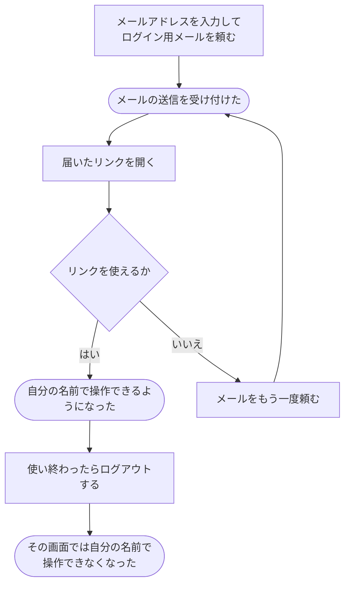

# ログインして、使い終わったらログアウトする

[シナリオの一覧へ](../../mutation-scenarios.md)

## したいこと

登録した人がメールのリンクを使ってログインする。使い終えたらログアウトし、その画面から自分の名前で操作できないようにする。

## 誰が、誰に、何をしてよいか

| 操作 | 誰が | 誰に／何に・範囲 |
| --- | --- | --- |
| メールのログイン用リンクを頼む（A2-01） | 登録済みメールを使う本人 | 自分のログイン |
| メールのリンクでログインする（A2-02） | 有効なログイン用リンクでメールを確認した本人 | 自分の利用者 |
| ログアウトする（A2-03） | ログインしている本人 | 自分の現在のログイン状態 |

本人に対する操作だけを扱う。サービス管理者という理由だけで、他の人の認証手段やプロフィールを変更することはできない。全操作の対応は[許可条件の一覧](../../permission-operations.md)を参照する。

## 始める前

メールのリンクでログインするには、利用登録を終えていて、登録したメールアドレスでメールを受け取れること。ログアウトは、ログインに使った方法にかかわらず行える。

## 流れ

## できたと言えること

- 有効なリンクを使った本人がログインできる。
- リンクを使えないときは、送り直しの案内がある。
- ログアウト後に、ログインが必要な操作をそのまま続けられない。

## まだ決めること

- リンクをいつまで、何回使えるようにするか。
- ログインしたままでいられる期間と、ログアウトがほかの端末にも影響するか。

## つながる話

- [メールで利用登録する](register.md)
- [外部サービスのアカウントでログインする](sign-in-with-another-service.md)
- [今の利用者に、別のログイン方法を追加する](add-sign-in-method.md)
- [追加していたログイン方法を外す](remove-sign-in-method.md)
- [解答を提出して採点してもらう](../submissions/submit-answer.md)
