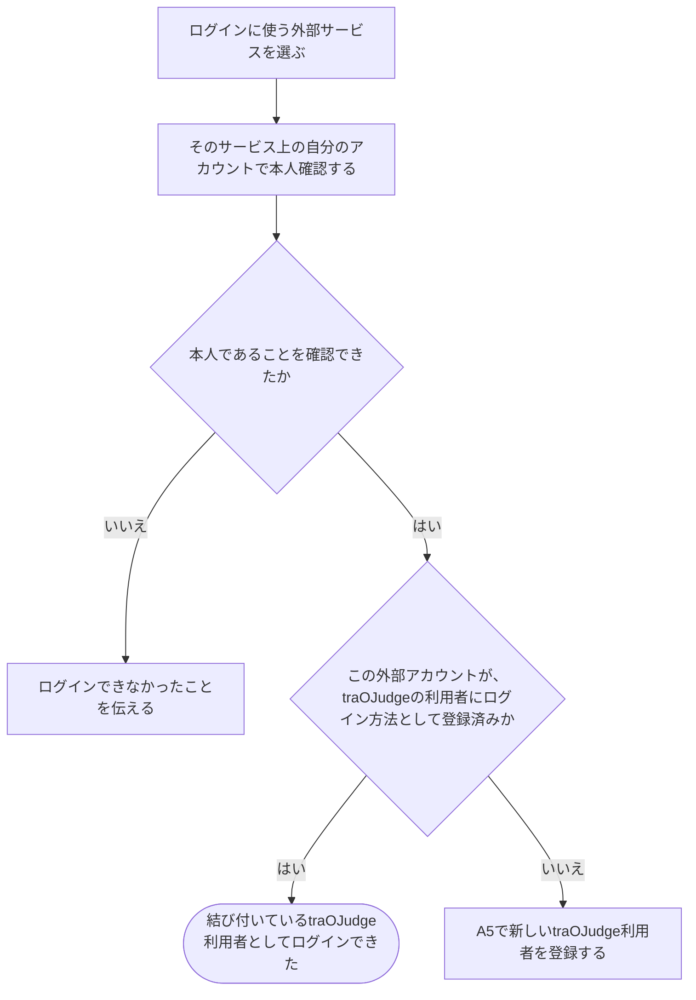

# 外部サービスのアカウントでログインする

[シナリオの一覧へ](../../mutation-scenarios.md)

## したいこと

登録した人が、自分の利用登録につないである外部サービスのアカウントを使ってログインする。以前の提出や参加した大会を引き継いで、同じ利用者として使い続ける。

## 誰が、誰に、何をしてよいか

| 操作 | 誰が | 誰に／何に・範囲 |
| --- | --- | --- |
| 外部アカウントでログインする（A6-01） | 登録済みの外部アカウントで本人確認ができた本人 | その外部アカウントに対応する自分の利用者 |

本人に対する操作だけを扱う。サービス管理者という理由だけで、他の人の認証手段やプロフィールを変更することはできない。全操作の対応は[許可条件の一覧](../../permission-operations.md)を参照する。

## 始める前

外部アカウントで本人確認できること。すでにその外部アカウントをログイン方法として登録していれば、その利用者としてログインする。まだ登録されていなければ、A5で新しいtraOJudge利用者を登録する。外部認証先は traQ・Google・GitHub の3つ。

## 外部アカウントと利用者

- **外部サービス**は traQ・Google・GitHub のこと。
- **外部アカウント**は、そのサービス上にある本人のアカウント。サービス名と、そのサービス内で変わらないアカウントIDの組み合わせで区別する。メールアドレスだけでは区別しない。
- **利用者**は traOJudge 内のアカウント。`userId` で識別し、プロフィール、役割、提出や大会参加の記録を持つ。
- **ログイン方法**は、1つの外部アカウントを1人のtraOJudge利用者へ結び付けたもの。

Googleアカウントが特定のtraOJudge利用者に結び付いていれば、その利用者としてログインする。結び付きがなければ、そのGoogleアカウントではまだtraOJudge利用者として登録されていないため、A5で新しい利用者を登録する。Googleのメールアドレスが既存利用者と同じでも、その利用者へ自動で結び付けない。

## 流れ

## APIの呼び出し順

WebUIとAPIは同一オリジンで、ブラウザのOriginを検証する。本人の識別には、選んだ外部サービスと、そのサービス内で変わらないアカウントIDの組み合わせを使う。メールアドレスの一致では利用者を特定したり、ログイン方法を追加したりしない。

1. WebUIでログインに使う外部サービスを選び、`POST /api/v1/auth/external/sessions` に開始要求を送る。

   `201 Created` で、外部サービスへ移動するURLと、この認証操作を示すID、有効期限を受け取る。応答は `Cache-Control: no-store` とする。

2. WebUIが `authorizationUrl` を開く。本人確認に成功すると、外部サービスから戻った認可情報を使って `POST /api/v1/auth/external/sessions/{authorizationId}/complete` を呼ぶ。

   APIは認可コードを外部サービスに照会し、開始時の外部サービス・目的・ブラウザ・有効期限との対応を検証する。確認できた外部アカウントが既存のログイン方法に結び付いている場合、その結び付き先の `userId` と有効期限を `200 OK` で返し、そのtraOJudge利用者のセッションCookieを発行する。

   本人確認に成功しても対応するログイン方法がない場合は、`404 Not Found`（`code=external_identity_not_registered`）を返す。この応答では利用者もセッションも作らない。画面はA5へ進み、同じ外部アカウントで登録手続きを行い、表示名を受け取って新しいtraOJudge利用者を作る。Googleなどから得たメールアドレスが既存利用者と一致しても、自動では結び付けない。認証に失敗・中断した場合も利用者やログイン状態を作らない。

   外部サービスが停止中などで本人確認を完了できない場合もログイン失敗として扱う。APIはエラーを返し、利用者を特定せず、セッションも作らない。画面はログインできなかったことを伝える。

3. ログイン後の本人情報と役割を得るため、ブラウザがセッションCookieを付けて `GET /api/v1/me` を呼ぶ。`200 OK` でプロフィールと役割が返り、有効期限を90日後まで延長するCookieも更新される。

セッションは [A2のログイン・ログアウトの条件](sign-in-and-out.md) に従い、有効なアクセスごとに90日後まで延長する。ログアウトで失効するのは現在のセッションだけ。

## できたと言えること

- 外部アカウントにつながっている利用者としてログインできる。
- それまでの提出・大会への参加・できる仕事の範囲が、同じ利用者のものとして続く。
- 利用者が途中でやめたときや、確認に失敗したときは、ログインできたことにしない。
- まだつないでいない外部アカウントを、勝手に既存の利用者へ追加しない。

## つながる話

- [外部サービスのアカウントで利用登録する](register-with-another-service.md)
- [今の利用者に、別のログイン方法を追加する](add-sign-in-method.md)
- [使い終わったらログアウトする](sign-in-and-out.md)
- [追加していたログイン方法を外す](remove-sign-in-method.md)
