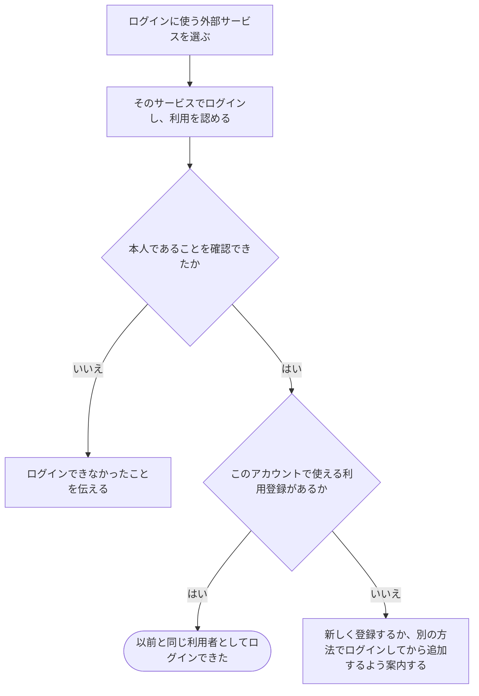

# 外部サービスのアカウントでログインする

[シナリオの一覧へ](../../mutation-scenarios.md)

## したいこと

登録した人が、自分の利用登録につないである外部サービスのアカウントを使ってログインする。以前の提出や参加した大会を引き継いで、同じ利用者として使い続ける。

## 誰が、誰に、何をしてよいか

| 操作 | 誰が | 誰に／何に・範囲 |
| --- | --- | --- |
| 外部アカウントでログインする（A6-01） | 登録済みの外部アカウントで本人確認ができた本人 | その外部アカウントに対応する自分の利用者 |

本人に対する操作だけを扱う。サービス管理者という理由だけで、他の人の認証手段やプロフィールを変更することはできない。全操作の対応は[許可条件の一覧](../../permission-operations.md)を参照する。

## 始める前

利用登録を終えていて、使いたい外部アカウントを自分のログイン方法として登録してあること。その外部アカウントでログインできること。候補は Google・GitHub・traQ であり、どれを提供するかはまだ決めていない。

## 流れ

## できたと言えること

- 外部アカウントにつながっている利用者としてログインできる。
- それまでの提出・大会への参加・できる仕事の範囲が、同じ利用者のものとして続く。
- 利用者が途中でやめたときや、確認に失敗したときは、ログインできたことにしない。
- まだつないでいない外部アカウントを、勝手に既存の利用者へ追加しない。

## まだ決めること

- Google・GitHub・traQ のうち、どれを提供するか。
- 外部サービスを利用できないときの案内と、別のログイン方法への進み方。
- ログインしたままでいられる期間と、ログアウトがほかの端末にも影響するか。

## つながる話

- [外部サービスのアカウントで利用登録する](register-with-another-service.md)
- [今の利用者に、別のログイン方法を追加する](add-sign-in-method.md)
- [使い終わったらログアウトする](sign-in-and-out.md)
- [追加していたログイン方法を外す](remove-sign-in-method.md)
