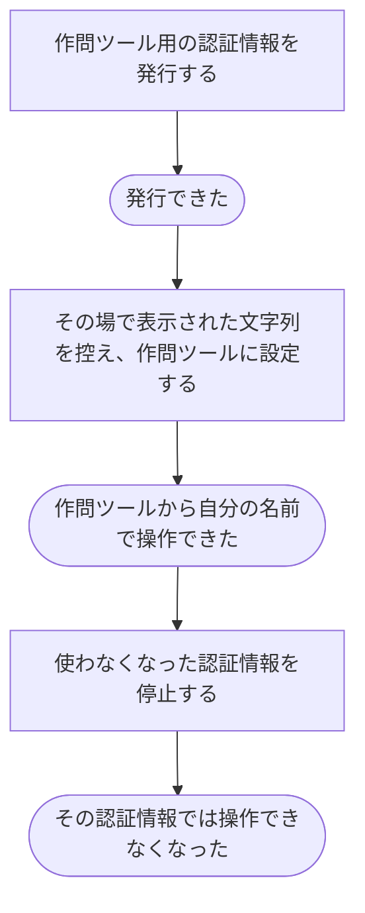

# 手元の作問ツールを使えるようにする・使えなくする

[シナリオの一覧へ](../../mutation-scenarios.md)

## したいこと

作問者が、手元の作問ツールに設定するための認証情報を発行する。使わなくなったものや、漏れたおそれがあるものは停止する。

## 誰が、誰に、何をしてよいか

| 操作 | 誰が | 誰に／何に・範囲 |
| --- | --- | --- |
| 作問ツール用の認証手段を発行する（A4-01） | ログインしている本人 | 自分の作問ツール用の認証手段 |
| 作問ツール用の認証手段を無効にする（A4-02） | ログインしている本人 | 自分が持つ指定した認証手段 |

本人に対する操作だけを扱う。サービス管理者という理由だけで、他の人の認証手段やプロフィールを変更することはできない。全操作の対応は[許可条件の一覧](../../permission-operations.md)を参照する。

## 始める前

本人がログインしていること。発行・無効化の対象は自分の認証手段だけ。問題を登録するときは別に、登録内容ごとの変更の許可も持つこと。認証手段を発行しても `writer` や問題の担当は自動で付かない。

## 流れ

## APIの呼び出し順

発行と失効にはログイン中のセッションCookieと、許可したWebUIのOriginが必要。

1. 必要なら `GET /api/v1/me/developer-tokens` で自分のトークン情報を確認する。秘密の文字列は返らない。

2. `POST /api/v1/me/developer-tokens` で名前を付けて発行する。有効期限を指定しなければ無期限。

   成功時は `201 Created`。秘密の文字列はこの応答で一度だけ返る。

3. 作問ツールからCLI APIを呼ぶ際は、秘密の文字列をBearerトークンとして送る。

4. 使わなくなったら一覧の `id` を指定して `DELETE /api/v1/me/developer-tokens/{developerTokenId}` を呼ぶ。成功時は `204 No Content`。その時点から、その秘密の文字列による新しいCLI API要求は拒否される。すでに発行されたファイルのアップロードURLは、開発者トークンの失効では取り消さず、それぞれの `expiresAt` まで使える。すでに受け付けた登録は、登録開始時に受け取った登録専用の継続トークンで、登録の `expiresAt` まで状態確認と完了ができる。これらの期限内でも、登録完了時には現在の変更権限を確認する。

作問ツール用トークンを発行しても、`writer` や問題の担当は自動で付かない。CLIの操作時点で本人の権限を確認する。

## できたと言えること

- 発行した本人が作問ツールに設定できる。秘密の文字列は発行したときだけ表示する。
- ツールからも、その利用者に許されている操作だけができる。
- 停止したものや期限が切れたものでは操作できない。

## まだ決めること

- なし。

## つながる話

- [できることを増やす・減らす](../permissions/change-permissions.md)
- [手元で作った問題のファイルを登録する](../problems/upload-problem-files.md)
