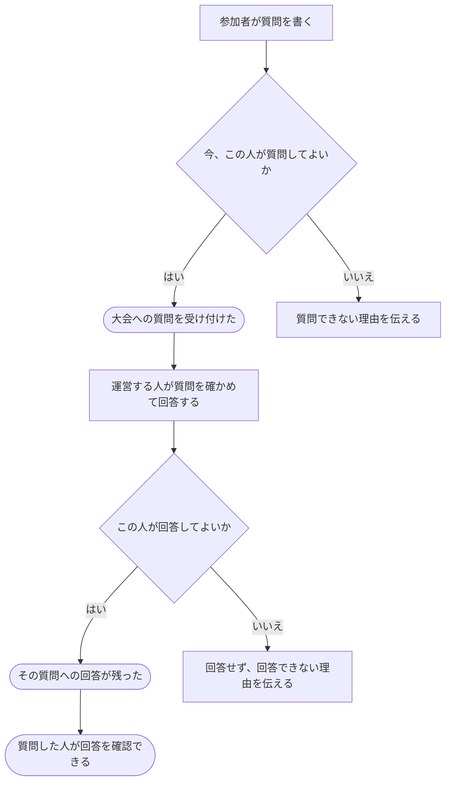

# 大会について質問し、回答する

[シナリオの一覧へ](../../mutation-scenarios.md)

## したいこと

大会の参加者が、問題文や大会の進め方について質問する。運営する人がその質問に答え、質問した人が回答を確認できるようにする。

## 始める前

質問する人は対象の大会に参加していること。回答する人は、その大会で質問に答えられる立場であること。

## 流れ

## できたと言えること

- 質問と、その質問への回答が対応して残る。
- 質問や回答をできる人の範囲を守る。
- どの大会でのやり取りなのかが分かる。

## まだ決めること

- 質問と回答を、質問者だけに見せるか、ほかの参加者にも見せるか。
- 質問・回答できる期間と、投稿後の訂正を認めるか。
- 回答が届いたことを、質問した人にどう知らせるか。

## つながる話

- [大会に参加する](../permissions/join-contest.md)
- [できることを増やす・減らす](../permissions/change-permissions.md)
