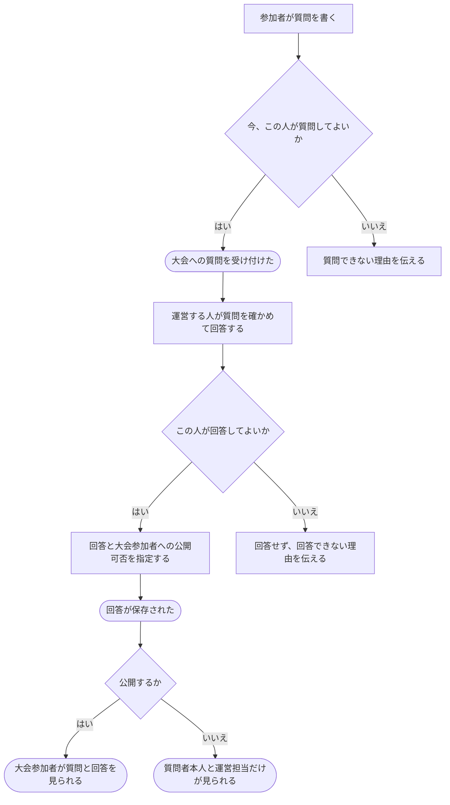

# 大会について質問し、回答する

[シナリオの一覧へ](../../mutation-scenarios.md)

## したいこと

通常大会の参加者が、問題文や大会の進め方について質問する。運営する人は質問に回答するとき、その質問と回答を大会参加者に公開するか選ぶ。バーチャル大会には質問機能を設けない。

## 誰が、誰に、何をしてよいか

| 操作 | 誰が | 誰に／何に・範囲 |
| --- | --- | --- |
| 通常の大会に質問する（C3-01） | 通常大会Cの contestant | その大会Cに、自分の質問を投稿 |
| 通常の大会の質問に回答する（C3-02） | 通常大会Cの contest-setter | 大会Cに寄せられた参加者の質問。回答を大会参加者に公開するか指定 |

根拠は[ロール定義](../../../domain/role.md)。書かれていない役割の許可は補わない。全操作の対応は[許可条件の一覧](../../permission-operations.md)を参照する。

## 始める前

本人がログインしていること。通常大会への質問はその大会の `contestant`、回答はその大会の `contest-setter` が行う。別の大会の参加者・運営担当というだけでは許可しない。

## 流れ

1. 参加者は `GET /api/v1/contests/{contestId}/clarifications` で、自分が閲覧できる質問と回答を取得する。自分の質問と公開された質問・回答を返す。`problemId` がある公開質問は、その問題を含む他の通常大会の質問一覧にも含める。運営担当には対象大会に寄せられた全質問を返す。
2. `POST /api/v1/contests/{contestId}/clarifications` に `{ "problemId": "problem_123", "body": "この条件について教えてください" }` を送る。大会全体への質問では `problemId` を省略する。受付応答には `answer: null`、`isPublic: false` が含まれる。
3. 運営担当は質問の `ETag` を使い、`PUT /api/v1/contests/{contestId}/clarifications/{clarificationId}/answer` に回答と公開設定を送る。

   ```json
   {
     "body": "この条件は入力に含まれます。",
     "isPublic": true
   }
   ```

   `isPublic: true` なら質問と回答を公開する。`problemId` がある質問はその問題を含む全ての通常大会の参加者に、ない質問はこの大会の参加者に公開する。`false` なら質問者本人と質問を受け付けた大会の運営担当だけが閲覧できる。
4. 回答後は同じ一覧・詳細APIで `answer` と `isPublic` を確認する。



## できたと言えること

- 質問と、その質問への回答が対応して残る。
- 上表の参加者だけが自分の質問を投稿し、その大会の運営担当だけが回答できる。
- 回答時に公開を選ぶと、コンテスト全体への質問はその大会の参加者に公開し、問題への質問はその問題を含む全ての通常大会の参加者に公開する。非公開を選ぶと、質問者本人と質問を受け付けた大会の運営担当だけが閲覧できる。
- 参加者は自分の質問を常に閲覧でき、運営担当は大会内の全質問を閲覧できる。
- 大会の責任者や問題の管理担当という役割だけでは、質問に回答できない。
- どの大会でのやり取りなのかが分かる。

## まだ決めること

- 質問・回答できる期間と、投稿後の訂正を認めるか。
- 回答が届いたことを、質問した人にどう知らせるか。

## つながる話

- [大会に参加する](../permissions/join-contest.md)
- [できることを増やす・減らす](../permissions/change-permissions.md)
