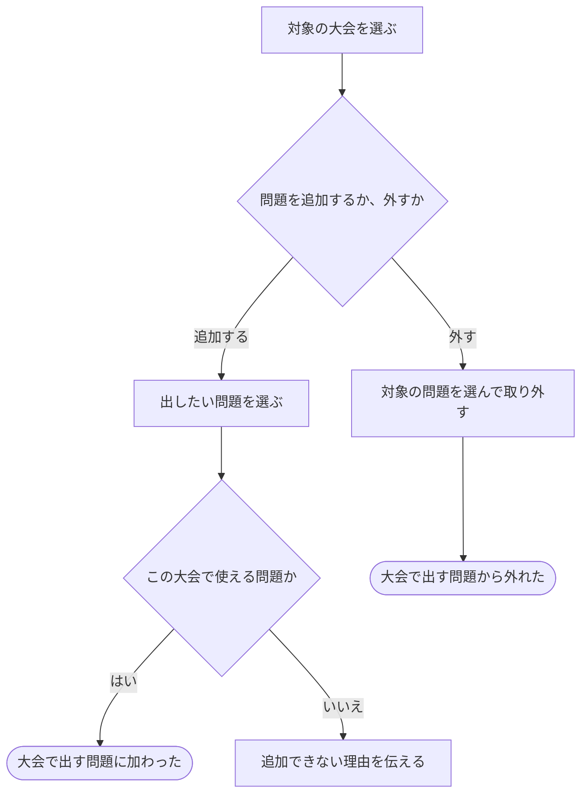

# 大会で出す問題を選ぶ・外す

[シナリオの一覧へ](../../mutation-scenarios.md)

## したいこと

大会を運営する人が、その大会で出す問題を選んで追加する。出題を取りやめる問題は、大会から外す。

## 始める前

対象の大会があり、その大会の問題構成を変えられること。通常の大会では自分の問題を追加でき、好きな時間に挑戦する大会では公開されている問題を使えるというルールに従う。

## 流れ

## できたと言えること

- その大会で使ってよい問題を追加できる。
- 大会から外す操作と、元の問題そのものを削除する操作を区別する。
- 変更できない人の操作では、大会の問題構成を変えない。

## まだ決めること

- 問題を追加・取り外しできる期間と、開催中・終了後の扱い。
- 追加後に元の問題が更新・非公開化・削除された場合にどうするか。
- どの時点の問題内容を大会で使うか。

## つながる話

- [大会を用意し、予定やルールを決める](organize-contest.md)
- [問題や解説を見せる相手を変える](../permissions/share-content.md)
- [大会に参加する](../permissions/join-contest.md)
