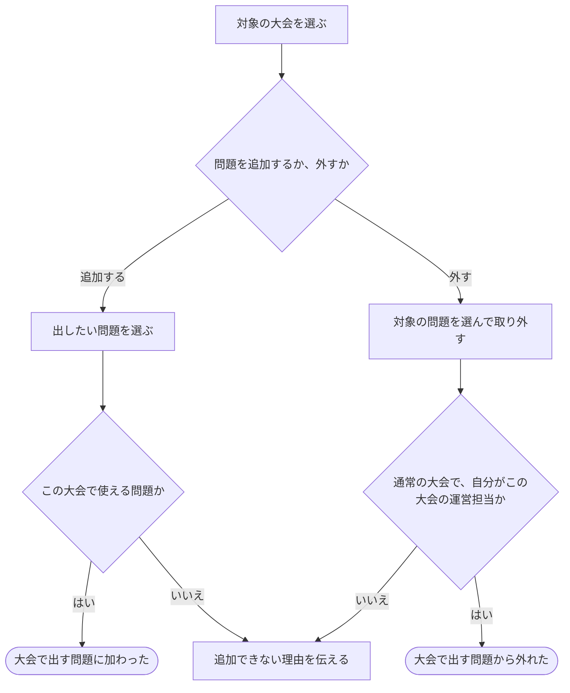

# 大会で出す問題を選ぶ・外す

[シナリオの一覧へ](../../mutation-scenarios.md)

## したいこと

大会を運営する人が、その大会で出す問題を選んで追加する。出題を取りやめる問題は、大会から外す。

## 誰が、誰に、何をしてよいか

| 操作 | 誰が | 誰に／何に・範囲 |
| --- | --- | --- |
| 通常の大会に問題を追加する（C2-01） | 通常大会Cの contest-setter | 大会Cに、自身の問題Pを追加。「自身」の判定基準は未決 |
| 通常の大会から問題を外す（C2-02） | 通常大会Cの contest-setter | 大会Cに含まれる任意の問題P。自分の問題に限らない |
| バーチャル大会に問題を追加する（C2-03） | バーチャル大会Vの virtual-contest-setter | 大会Vに、公開された問題Pを追加。自分の問題に限らない |
| バーチャル大会から問題を外す（C2-04） | 未決。virtual-contest-setter に明示された操作ではない | 大会Vに含まれる問題P |

根拠は[ロール定義](../../../domain/role.md)。書かれていない役割の許可は補わない。全操作の対応は[許可条件の一覧](../../permission-operations.md)を参照する。

## 始める前

本人がログインし、対象の通常大会の `contest-setter`、またはバーチャル大会の `virtual-contest-setter` を持つこと。通常の大会への追加は自身の問題に限るが、取り外す場合は自分以外の問題でもよい。バーチャル大会への追加は公開問題に限り、取り外しの許可は未決。

## 流れ

## できたと言えること

- その大会で使ってよい問題を追加できる。
- 大会から外す操作と、元の問題そのものを削除する操作を区別する。
- 変更できない人の操作では、大会の問題構成を変えない。

## まだ決めること

- 問題を追加・取り外しできる期間と、開催中・終了後の扱い。
- 「自身の問題」を作成者で判断するか、現在の管理担当で判断するか。
- バーチャル大会から問題を外す操作を誰に許可するか。
- 追加後に元の問題が更新・非公開化・削除された場合にどうするか。
- どの時点の問題内容を大会で使うか。

## つながる話

- [大会を用意し、予定やルールを決める](organize-contest.md)
- [問題や解説を見せる相手を変える](../permissions/share-content.md)
- [大会に参加する](../permissions/join-contest.md)
