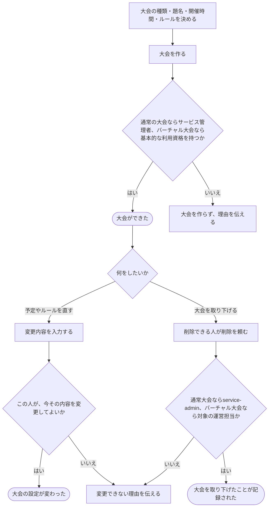

# 大会を用意し、予定やルールを決める

[シナリオの一覧へ](../../mutation-scenarios.md)

## したいこと

大会を作れる人が、題名、開催時間、採点のルール、参加方式などを決めて大会を用意する。参加方式は個人戦またはチーム戦から選び、チーム戦ではその大会内でチームを作る。運営する人は、変更してよい期間に設定を直す。削除できる人は大会を取り下げる。

## 誰が、誰に、何をしてよいか

| 操作 | 誰が | 誰に／何に・範囲 |
| --- | --- | --- |
| 通常の大会を作る（C1-01） | サービス管理者（service-admin） | 新規の通常大会 |
| 通常の大会の題名・公開範囲・概要・ルール・開始終了時刻・参加方式を変更する（C1-02） | 通常大会Cの contest-setter | その大会C。題名・公開範囲・開始時刻・ルール・参加方式は開始前に限る |
| 通常の大会を削除する（C1-03） | サービス管理者（service-admin） | 指定した通常大会C |
| バーチャル大会を作る（C1-04） | 基本的な利用資格を持つ人（standard-user） | 新規のバーチャル大会 |
| バーチャル大会の題名・公開範囲・ルール・開始終了時刻を変更する（C1-05） | バーチャル大会Vの virtual-contest-setter | その大会V |
| バーチャル大会を削除する（C1-06） | バーチャル大会Vの virtual-contest-setter | 指定したバーチャル大会V |

根拠は[ロール定義](../../../domain/role.md)。書かれていない役割の許可は補わない。全操作の対応は[許可条件の一覧](../../permission-operations.md)を参照する。

## 始める前

本人がログインし、通常の大会の作成・削除には `service-admin`、バーチャル大会の作成には `standard-user` を持つこと。ルールや開催時間の変更には、対象大会の `contest-setter` / `virtual-contest-setter` を持つこと。大会の責任者であることだけでは、ルール変更を許可しない。バーチャル大会の削除には対象大会のvirtual-contest-setterを持つこと。

## 流れ

## できたと言えること

- 大会の開催時間や採点ルールが、その大会の情報として残る。
- 個人戦またはチーム戦の参加方式が、その大会の情報として残る。チーム戦では、その大会内のチームに参加者が所属する。
- 開始時刻より前に参加方式を変更した場合、それまでの参加登録と大会内チームがすべて削除される。開始時刻以降は変更できない。
- 通常大会の概要をMarkdownで記述し，コンテストtopに表示できる．[概要テンプレート](../../../ui/contest-overview-template.md)を利用できる．
- 開始後は題名・公開範囲・開始時刻・ルール・参加方式を固定し、終了時刻と通常大会の概要だけを変更できる。
- 通常大会の作成者に役割を自動付与せず、service-adminがcontest-adminを任命する。バーチャル大会の作成者にはvirtual-contest-setterを自動付与する。
- 同点のときの順位の決め方や、誤答による加算時間は、開始前までに決め、開始後は変えない。
- 題名と公開範囲は、対象大会の運営担当が開始前だけ変更できる。
- バーチャル大会も全員が共通の開始・終了時刻を使い、個人別開始・再挑戦は設けない。
- 取り下げても、過去の大会だったことが分かる記録を残す。

## まだ決めること

- 取り下げた大会の見せ方。

## つながる話

- [できることを増やす・減らす](../permissions/change-permissions.md)
- [大会で出す問題を選ぶ・外す](choose-problems.md)
- [大会に参加する](../permissions/join-contest.md)
