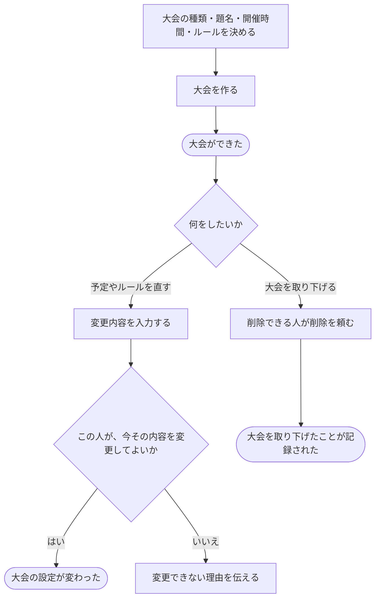

# 大会を用意し、予定やルールを決める

[シナリオの一覧へ](../../mutation-scenarios.md)

## したいこと

大会を作れる人が、題名、開催時間、採点のルールなどを決めて大会を用意する。運営する人は、変更してよい期間に設定を直す。削除できる人は大会を取り下げる。

## 始める前

通常の大会を作る場合と、好きな時間に挑戦する大会を作る場合の、それぞれで必要な立場を満たしていること。すでにある大会を直すときは、その操作をしてよいこと。

## 流れ

## できたと言えること

- 大会の開催時間や採点ルールが、その大会の情報として残る。
- 変更できる人・期間・項目の範囲で設定を直せる。
- 同点のときの順位の決め方や、誤答による加算時間は、開始前までに決め、開始後は変えない。
- 取り下げても、過去の大会だったことが分かる記録を残す。

## まだ決めること

- 作った人に最初からどの運営の仕事を任せるか。
- 通常の大会と、好きな時間に挑戦する大会で、開始・終了の考え方をどう分けるか。
- 開催中・終了後に変えられる項目と、取り下げた大会の見せ方。

## つながる話

- [できることを増やす・減らす](../permissions/change-permissions.md)
- [大会で出す問題を選ぶ・外す](choose-problems.md)
- [大会に参加する](../permissions/join-contest.md)
