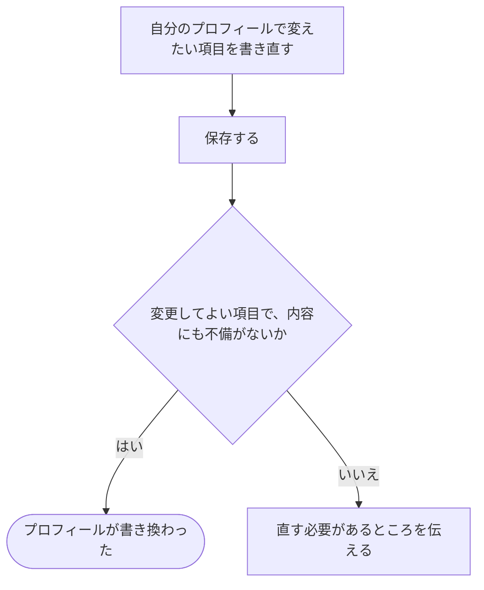

# プロフィールを書き直す

[シナリオの一覧へ](../../mutation-scenarios.md)

## したいこと

利用者が、表示名・自己紹介・GitHub・AtCoder・Xのユーザー名など、自分のプロフィールを変更する。SNS等のユーザー名は本人申告であり、外部サービスのアカウントとの認証・連携には使わない。

## 誰が、誰に、何をしてよいか

| 操作 | 誰が | 誰に／何に・範囲 |
| --- | --- | --- |
| プロフィールを書き換える（O2-01） | ログインしている本人 | 自分のプロフィール。ほかの人のプロフィールは対象外 |

本人に対する操作だけを扱う。サービス管理者という理由だけで、他の人の認証手段やプロフィールを変更することはできない。全操作の対応は[許可条件の一覧](../../permission-operations.md)を参照する。

## 始める前

自分の名前でログインしていること。変更したい項目と、新しく載せたい内容が分かっていること。

## 流れ

1. `GET /api/v1/me` で現在のプロフィールと `ETag` を取得する。応答には `githubId`、`atcoderId`、`xId` も含み、未設定の値は空文字で返す。
2. 変更する項目を書き換え、`PATCH /api/v1/me` に変更項目と `If-Match` を付けて送る。変更しない項目は省略し、ユーザー名を消すときは空文字を送る。
3. 保存に成功すると、更新後のプロフィールと新しい `ETag` が返る。別の更新が先に行われていれば `412 Precondition Failed` となり、最新状態を取得し直す。

## できたと言えること

- 自分が変更してよい項目だけを書き換えられる。他の人のプロフィールは変更できない。
- 保存できた場合は、新しい内容を確認できる。
- 内容に不備があるときは、保存できたように案内しない。

## まだ決めること

- SNS等のユーザー名に対する書式・文字数の制限。
- アイコンを変更するときの操作と、使える画像の条件。

## つながる話

- [ログインして、使い終わったらログアウトする](../authentication/sign-in-and-out.md)
- [登録したメールアドレスを変える](../authentication/change-email.md)
