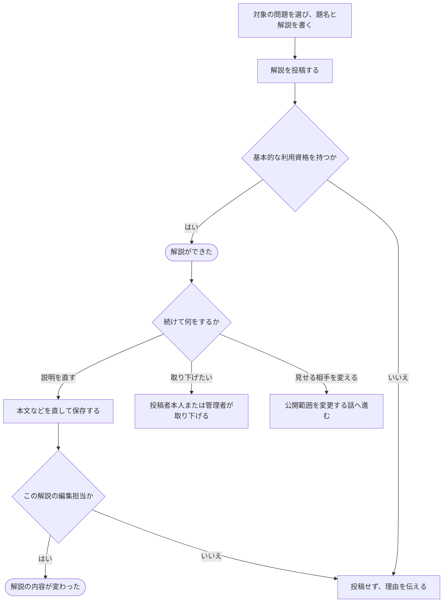

# 解説を書き、直す・取り下げる

[シナリオの一覧へ](../../mutation-scenarios.md)

## したいこと

問題について説明したい人が、解説を書く。編集担当になった人が、あとで説明を直す。投稿者本人またはサービス管理者が取り下げられる。見せる相手を変える操作は別の話としてつなぐ。

## 誰が、誰に、何をしてよいか

| 操作 | 誰が | 誰に／何に・範囲 |
| --- | --- | --- |
| 解説を投稿する（O1-01） | 基本的な利用資格を持つ人（standard-user） | 問題Pに、新しい自分の解説 |
| 解説を編集する（O1-02） | 解説Eの編集担当（参照元の表記は editiorial-author） | その解説E |
| 解説を削除する（O1-03） | 投稿者本人、またはservice-admin。編集担当であることだけでは許可しない | 解説E |

根拠は[ロール定義](../../../domain/role.md)。書かれていない役割の許可は補わない。全操作の対応は[許可条件の一覧](../../permission-operations.md)を参照する。

## 始める前

本人がログインし、新しい解説の投稿には `standard-user`、既存の解説の編集にはその解説の `editiorial-author` を持つこと。対象の問題があること。暫定仕様として非公開で作成し、作成者にその解説の編集担当を同時に付ける。問題の管理担当だから解説も編集できるとはしない。

## 流れ

## できたと言えること

- 解説した人と対象の問題が分かる形で、題名や本文が残る。
- 編集できる人が内容を直せる。
- 投稿しただけで、解答を提出したことや作問できる立場であることを必須条件にしない。
- 見せる相手の変更は、公開範囲を変える操作として扱う。
- 問題が取り下げられたら、その問題の解説も取り下げる。

## まだ決めること

- 非公開で作成し投稿者に編集担当を付ける暫定仕様を、正式仕様にするか。

## つながる話

- [問題や解説を見せる相手を変える](../permissions/share-content.md)
- [新しい問題を作り、内容を直す・取り下げる](../problems/create-problem.md)
