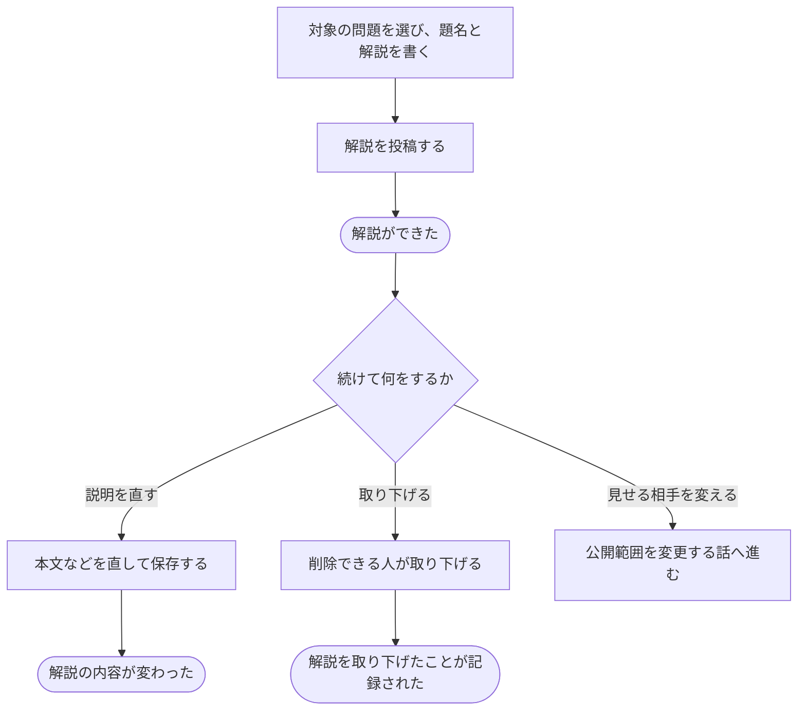

# 解説を書き、直す・取り下げる

[シナリオの一覧へ](../../mutation-scenarios.md)

## したいこと

問題について説明したい人が、解説を書く。あとで説明を直し、削除できる立場なら取り下げる。見せる相手を変える操作は別の話としてつなぐ。

## 始める前

自分の名前でログインし、解説を書けること。対象の問題があること。既存の解説を直す・取り下げる場合は、その操作をしてよいこと。

## 流れ

## できたと言えること

- 解説した人と対象の問題が分かる形で、題名や本文が残る。
- 編集できる人が内容を直せる。
- 投稿しただけで、解答を提出したことや作問できる立場であることを必須条件にしない。
- 見せる相手の変更は、公開範囲を変える操作として扱う。

## まだ決めること

- 投稿した直後に誰が見られるようにするか。
- 解説を削除できる人の範囲と、元の問題が取り下げられた後の扱い。

## つながる話

- [問題や解説を見せる相手を変える](../permissions/share-content.md)
- [新しい問題を作り、内容を直す・取り下げる](../problems/create-problem.md)
