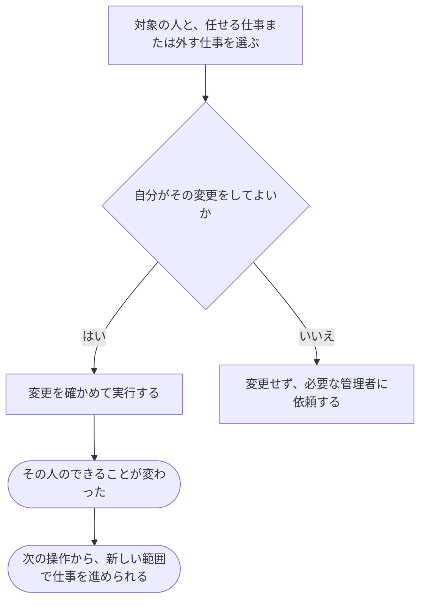

# できることを増やす・減らす

[シナリオの一覧へ](../../mutation-scenarios.md)

## したいこと

管理する立場の人が、対象の人に作問・共同作業・大会運営などを任せたり、任せていた仕事から外したりする。

## 始める前

操作する人が、対象の人の役割を変更できること。サービス全体・特定の問題・特定の大会の、どれについて変更するかが分かっていること。

## 流れ

## できたと言えること

- 指定した人・問題・大会についてだけ、できることが変わる。
- 変更できる立場の人だけが、追加や取り消しを行える。
- 大会の責任者が運営担当を追加する操作と、サービス管理者に外してもらう操作を区別する。

## まだ決めること

- 問題や大会を作った人に、最初にどの仕事を任せるか。
- 編集中に役割を外された場合、いつから変更を反映するか。

## つながる話

- [新しい問題を作り、内容を直す・取り下げる](../problems/create-problem.md)
- [大会を用意し、予定やルールを決める](../contests/organize-contest.md)
