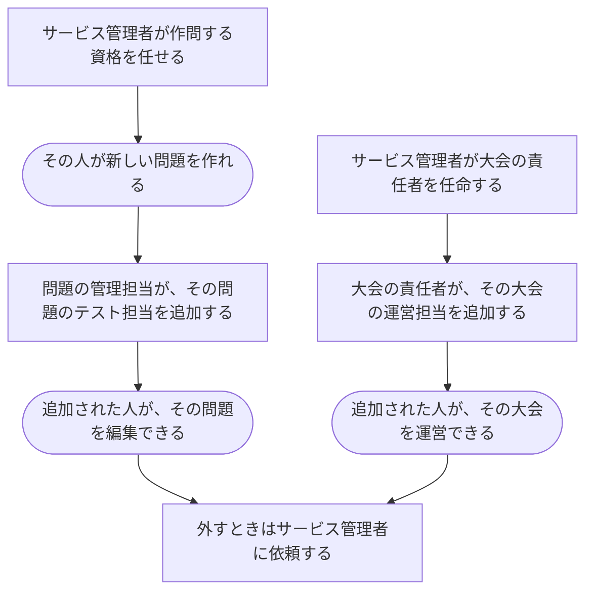

# 人に仕事を任せる・任せていた仕事から外す

[シナリオの一覧へ](../../mutation-scenarios.md) · [すべての操作の許可条件](../../permission-operations.md)

「権限を変更する」1本にはまとめず、任せる仕事と、任せる・外すをそれぞれ分ける。各リンク先が、担当を決めて実装するためのシナリオである。

[ロール定義](../../../domain/role.md)を根拠にする。サービス管理者は、自分と同じ `service-admin` 以外の役割を付けたり外したりできる。サービス管理者を任命・解任する方法は、この定義にはないため未決。

## 操作の一覧

| 番号 | 任せる仕事 | 誰が任せてよいか | 誰が外してよいか | 個別の話 |
| --- | --- | --- | --- | --- |
| R1-01 | 作問する資格（サービス全体） | サービス管理者（service-admin） | サービス管理者（service-admin） | [任せる](grant-writer.md) / [外す](revoke-writer.md) |
| R1-02 | 問題の管理担当（選んだ問題1つ） | サービス管理者（service-admin） | サービス管理者（service-admin） | [任せる](grant-problem-owner.md) / [外す](revoke-problem-owner.md) |
| R1-03 | 問題のテスト担当（選んだ問題1つ） | サービス管理者（service-admin）、またはその問題の管理担当（problem-owner） | サービス管理者（service-admin） | [任せる](grant-tester.md) / [外す](revoke-tester.md) |
| R1-04 | 通常の大会の責任者（選んだ通常の大会1つ） | サービス管理者（service-admin） | サービス管理者（service-admin） | [任せる](grant-contest-admin.md) / [外す](revoke-contest-admin.md) |
| R1-05 | 通常の大会の運営担当（選んだ通常の大会1つ） | サービス管理者（service-admin）、またはその大会の責任者（contest-admin） | サービス管理者（service-admin） | [任せる](grant-contest-setter.md) / [外す](revoke-contest-setter.md) |
| R1-06 | 好きな時間に挑戦する大会の運営担当（選んだバーチャル大会1つ） | サービス管理者（service-admin） | サービス管理者（service-admin） | [任せる](grant-virtual-contest-setter.md) / [外す](revoke-virtual-contest-setter.md) |
| R1-07 | 基本的な利用資格（サービス全体） | サービス管理者（service-admin） | サービス管理者（service-admin） | [任せる](grant-standard-user.md) / [外す](revoke-standard-user.md) |
| R1-08 | 解説の編集担当（選んだ解説1つ） | サービス管理者（service-admin） | サービス管理者（service-admin） | [任せる](grant-editorial-author.md) / [外す](revoke-editorial-author.md) |
| R1-09 | 通常の大会の参加資格（選んだ通常の大会1つ） | サービス管理者（service-admin） | サービス管理者（service-admin） | [任せる](grant-contestant.md) / [外す](revoke-contestant.md) |
| R1-10 | 好きな時間に挑戦する大会の参加資格（選んだバーチャル大会1つ） | サービス管理者（service-admin） | サービス管理者（service-admin） | [任せる](grant-virtual-contestant.md) / [外す](revoke-virtual-contestant.md) |

同じ役割でも、別の問題・大会・解説にまで許可を広げない。「大会の責任者だからルールも直せる」「テスト担当だから別のテスト担当を呼べる」といった、書かれていない上下関係は補わない。

## 話のつながり

問題を作った人が自動で管理担当になるか、大会を作った人が自動で責任者・運営担当になるかは未決。この図のつながりは、その間に必要な役割の割り当てが済んでいる場合を示す。

## 本人が申し込む話

- [公開された通常の大会に参加する](join-contest.md)
- [好きな時間に挑戦する大会に参加する](join-virtual-contest.md)（申し込みを許可する条件は未決）

本人が参加を申し込む操作と、サービス管理者が参加資格を付ける操作は分けて扱う。
