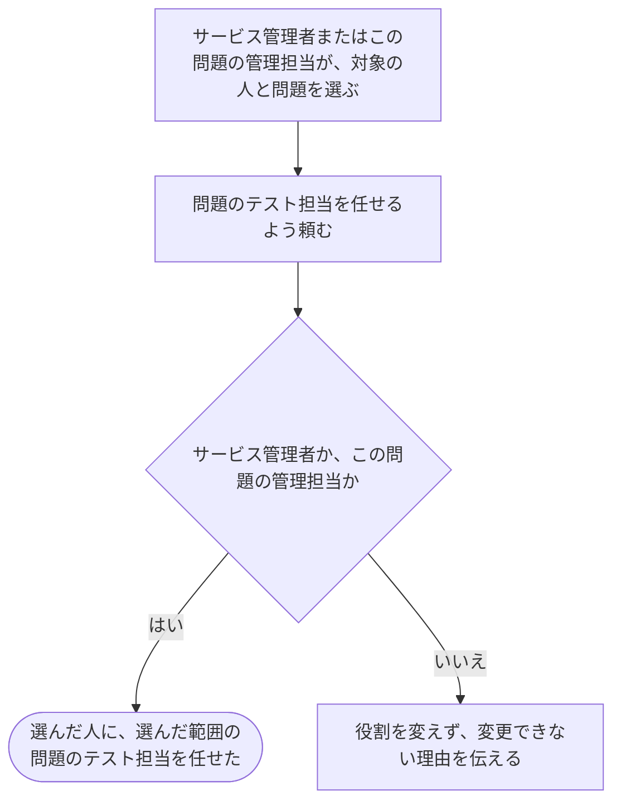

# 人に問題のテスト担当を任せる

[シナリオの一覧へ](../../mutation-scenarios.md) · [仕事を任せる・外す話の一覧](change-permissions.md)

## したいこと

サービス管理者（service-admin）、またはその問題の管理担当（problem-owner）が、選んだ問題1つについて、登録済みの人に問題のテスト担当を任せる。

## 誰が、誰に、何をしてよいか

| 確かめること | この操作での条件 |
| --- | --- |
| 誰が | サービス管理者（service-admin）、またはその問題の管理担当（problem-owner） |
| 誰に | 役割を任せたい、登録済みの人 |
| 何について | 選んだ問題1つ |
| 何をする | 選んだ人に `tester` を付ける |
| 任せる仕事 | その問題の閲覧・編集、採点のやり直し、既存の採点方法の更新ができる |

根拠は[ロール定義](../../../domain/role.md)の `service-admin` と `problem-owner`、仕事の範囲は `tester`。

## 始める前

操作する人がログインしていて、上記の立場を持つこと。対象の人と、対象の問題が存在し、どの人のどの範囲を変えるかが決まっていること。

## 流れ

## できたと言えること

- 選んだ人に、選んだ範囲の問題のテスト担当を任せたことが分かる。
- 別の人や、別の問題の役割を変えない。
- サービス管理者以外が追加できる役割は、テスト担当と通常の大会の運営担当について明記した場合に限る。
- その問題のテスト担当や、大会の運営担当という理由だけでは、別の人をテスト担当にできない。問題の削除や採点方法の追加・削除も任せない。

## まだ決めること

- すでに同じ仕事を任せていた人に、もう一度頼まれた場合の扱い。
- 自分自身を対象にする場合の条件と、変更の履歴を誰に見せるか。

## つながる話

- [同じ仕事から外す](revoke-tester.md)
- [任せる仕事に関係する話](../problems/edit-tests-and-judging.md)
