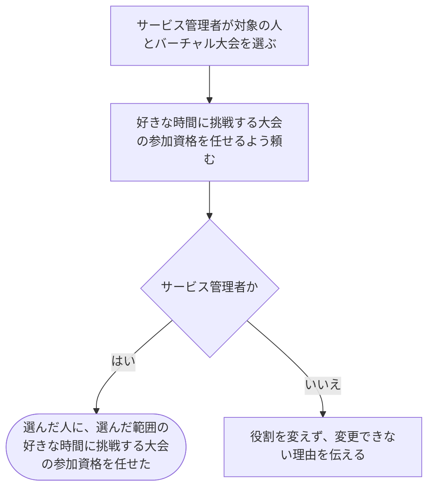

# 人に好きな時間に挑戦する大会の参加資格を任せる

[シナリオの一覧へ](../../mutation-scenarios.md) · [仕事を任せる・外す話の一覧](change-permissions.md)

## したいこと

サービス管理者（service-admin）が、選んだバーチャル大会1つについて、登録済みの人に好きな時間に挑戦する大会の参加資格を任せる。

## 誰が、誰に、何をしてよいか

| 確かめること | この操作での条件 |
| --- | --- |
| 誰が | サービス管理者（service-admin） |
| 誰に | 役割を任せたい、登録済みの人 |
| 何について | 選んだバーチャル大会1つ |
| 何をする | 選んだ人に `virtual-contestant` を付ける |
| 任せる仕事 | その大会の開催時間中に大会内の問題へ提出でき、その大会に質問できる |

根拠は[ロール定義](../../../domain/role.md)の `service-admin`、仕事の範囲は `virtual-contestant`。

## 始める前

操作する人がログインしていて、上記の立場を持つこと。対象の人と、対象のバーチャル大会が存在し、どの人のどの範囲を変えるかが決まっていること。

## 流れ

## できたと言えること

- 選んだ人に、選んだ範囲の好きな時間に挑戦する大会の参加資格を任せたことが分かる。
- 別の人や、別のバーチャル大会の役割を変えない。
- サービス管理者以外が追加できる役割は、テスト担当と通常の大会の運営担当について明記した場合に限る。
- 本人からの参加申し込みを受け付ける条件は未決。通常の大会への参加とは区別する。

## まだ決めること

- すでに同じ仕事を任せていた人に、もう一度頼まれた場合の扱い。
- 自分自身を対象にする場合の条件と、変更の履歴を誰に見せるか。

## つながる話

- [同じ仕事から外す](revoke-virtual-contestant.md)
- [任せる仕事に関係する話](join-virtual-contest.md)
