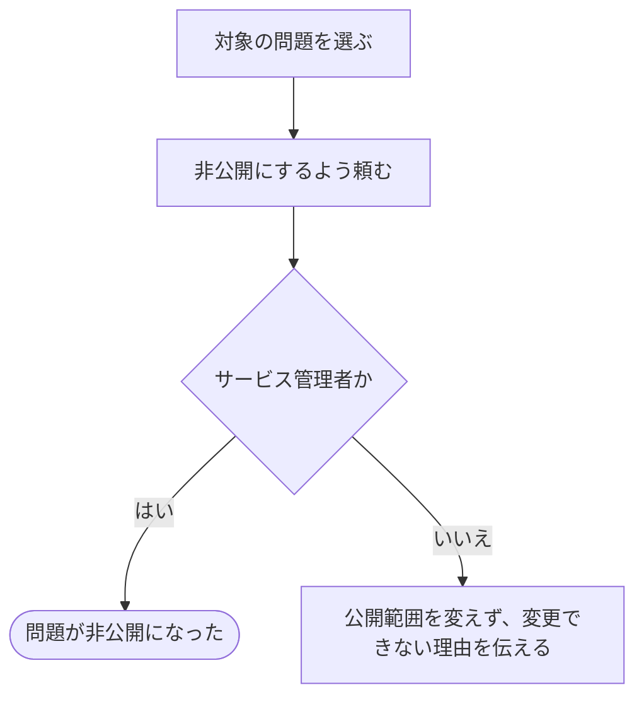

# 問題を非公開にする

[シナリオの一覧へ](../../mutation-scenarios.md) · [公開範囲を変える話の一覧](share-content.md)

## したいこと

サービス管理者が、公開されている問題を選び、一般に見せるのをやめる。

## 誰が、何に、何をしてよいか

| 確かめること | この操作での条件 |
| --- | --- |
| 誰が | サービス管理者（service-admin） |
| 何に | 自分の担当かどうかを問わず、指定した問題1つ |
| 何をする | 問題を非公開にする |
| 誰への影響か | その問題を公開されていることを理由に閲覧・利用していた人 |

[ロール定義](../../../domain/role.md)の `service-admin` に、すべての問題を非公開にできると明記されている。1回で全問題を非公開にする一括操作を意味しない。

## 始める前

サービス管理者がログインしていて、対象の問題が存在すること。

## 流れ

## できたと言えること

- サービス管理者が指定した問題だけを非公開にできる。
- 本文やファイル、担当する人の役割を、この操作で書き換えない。
- 許可条件が未決のものを、ログイン済みというだけで変更できるようにしない。

## まだ決めること

- 問題の管理担当やテスト担当も、非公開にしてよいか。
- 非公開化した後の既存の提出や、大会参加者からの利用の扱い。

## つながる話

- [問題を公開する](publish-problem.md)
- [問題の内容を用意する](../problems/upload-problem-files.md)
