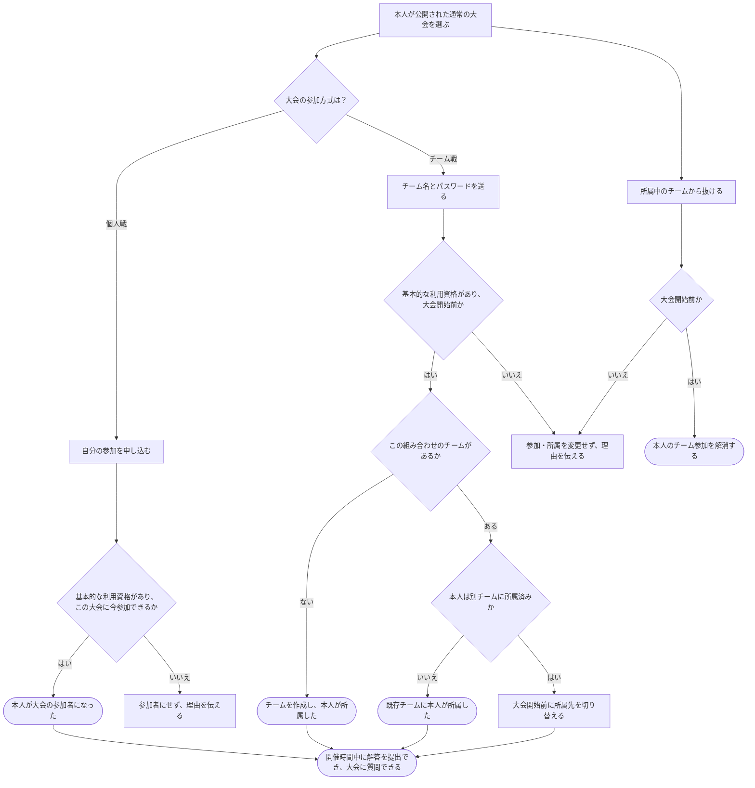

# 公開された通常の大会に参加する

[シナリオの一覧へ](../../mutation-scenarios.md)

## したいこと

参加したい人が、自分で公開された通常の大会に申し込む。個人戦では本人を参加者にし、チーム戦では大会内のチームを作るか既存チームに加わる。その大会で解答を提出したり、質問したりできるようになる。

## 誰が、誰に、何をしてよいか

| 確かめること | この操作での条件 |
| --- | --- |
| 誰が | 基本的な利用資格を持つ本人（standard-user） |
| 誰に | 自分自身にだけ。他の人を参加させる操作ではない |
| 何について | 公開された通常の大会1つ |
| 何をする | 個人戦では本人を参加者（contestant）にする。チーム戦ではチーム名とパスワードの組み合わせでチームを作るか、既存チームへ本人を参加させる |

根拠は[ロール定義](../../../domain/role.md)の `standard-user` と `contestant`。

## 始める前

本人がログインしていて、基本的な利用資格を持つこと。大会が公開されていて、申し込み時点の参加条件を満たすこと。個人戦の申し込み期間や参加条件の詳細はまだ決めていない。チーム戦の新規参加・チーム移動・脱退は、大会開始時刻より前に限る。

## 流れ

## できたと言えること

- 個人戦では本人だけが、選んだ公開大会の参加者になる。
- チーム戦では、同じ大会内のチーム名とパスワードで該当チームを特定し、なければ作成、あれば本人を参加させる。同じ大会の同一チーム名でもパスワードが異なれば別チームとして扱う。
- 1人が同じ大会で所属できるチームは1つまで。同じチームへの再要求は現在の所属を返す。大会開始前は別チームへの切り替えとチームからの脱退ができ、開始時刻以降は所属を固定する。
- チーム情報から所属メンバーの名前を取得できる。チームのパスワードは応答に含めない。
- 参加した大会の開催時間中に、大会内の問題へ提出できる。質問できる期間は別に決める。
- 別の人、別の大会の参加資格や、大会を運営する役割を変更しない。
- 基本的な利用資格がない人、非公開の大会への申し込みを、同じ条件で受け付けない。

## まだ決めること

- 申し込みができる期間や、追加の参加条件。
- 申し込みができる期間や、追加の参加条件、非公開大会への参加方法。

## つながる話

- [好きな時間に挑戦する大会に参加する](join-virtual-contest.md)
- [サービス管理者が通常の大会の参加資格を付ける](grant-contestant.md)
- [解答を提出して採点してもらう](../submissions/submit-answer.md)
- [大会について質問し、回答する](../contests/ask-and-answer.md)
