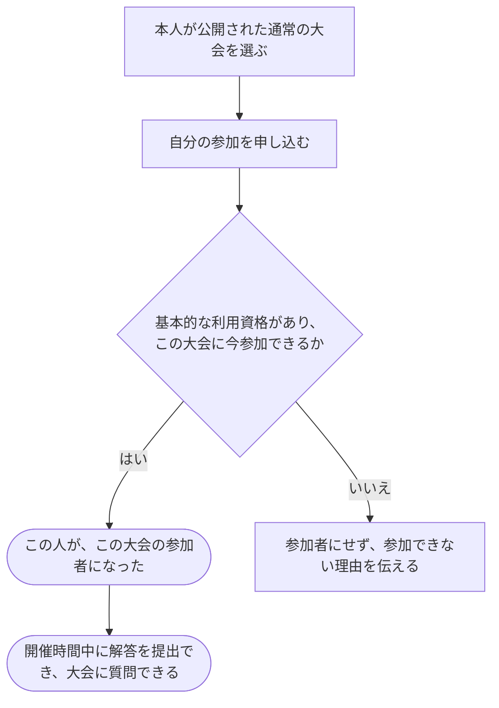

# 公開された通常の大会に参加する

[シナリオの一覧へ](../../mutation-scenarios.md)

## したいこと

参加したい人が、自分で公開された通常の大会に申し込み、その大会で解答を提出したり、質問したりできるようになる。

## 誰が、誰に、何をしてよいか

| 確かめること | この操作での条件 |
| --- | --- |
| 誰が | 基本的な利用資格を持つ本人（standard-user） |
| 誰に | 自分自身にだけ。他の人を参加させる操作ではない |
| 何について | 公開された通常の大会1つ |
| 何をする | 参加を申し込み、その大会の参加者（contestant）になる |

根拠は[ロール定義](../../../domain/role.md)の `standard-user` と `contestant`。

## 始める前

本人がログインしていて、基本的な利用資格を持つこと。大会が公開されていて、申し込み時点の参加条件を満たすこと。参加条件や申し込み期間の詳細はまだ決めていない。

## 流れ

## できたと言えること

- 本人だけが、選んだ公開大会の参加者になる。
- 参加した大会の開催時間中に、大会内の問題へ提出できる。質問できる期間は別に決める。
- 別の人、別の大会の参加資格や、大会を運営する役割を変更しない。
- 基本的な利用資格がない人、非公開の大会への申し込みを、同じ条件で受け付けない。

## まだ決めること

- 申し込みができる期間や、追加の参加条件。
- 同じ人がもう一度参加を申し込んだ場合の扱い。
- 参加を自分で取り消せるかと、非公開大会への参加方法。

## つながる話

- [好きな時間に挑戦する大会に参加する](join-virtual-contest.md)
- [サービス管理者が通常の大会の参加資格を付ける](grant-contestant.md)
- [解答を提出して採点してもらう](../submissions/submit-answer.md)
- [大会について質問し、回答する](../contests/ask-and-answer.md)
