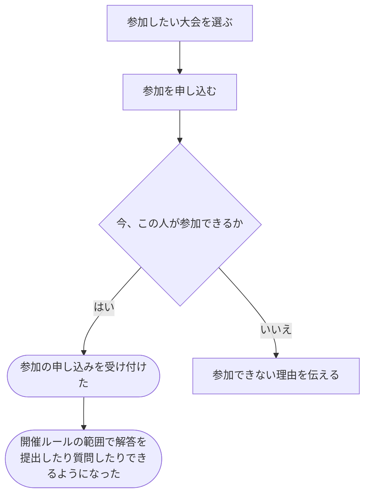

# 大会に参加する

[シナリオの一覧へ](../../mutation-scenarios.md)

## したいこと

参加したい人が大会に申し込み、その大会で解答を提出したり、質問したりできるようになる。

## 始める前

自分の名前でログインしていること。参加したい大会があり、その大会の参加条件を満たしていること。

## 流れ

## できたと言えること

- 参加できる人の申し込みが受け付けられる。
- 参加した大会について、開催ルールに従って解答の提出や質問ができる。
- 参加できない人を、参加できたように扱わない。

## まだ決めること

- 申し込みができる期間や、必要な参加条件。
- 好きな時間に挑戦する大会では、参加の申し込みと自分の開始時刻をどう結び付けるか。
- 同じ人がもう一度参加を申し込んだ場合の扱い。

## つながる話

- [大会を用意し、予定やルールを決める](../contests/organize-contest.md)
- [解答を提出して採点してもらう](../submissions/submit-answer.md)
- [大会について質問し、回答する](../contests/ask-and-answer.md)
