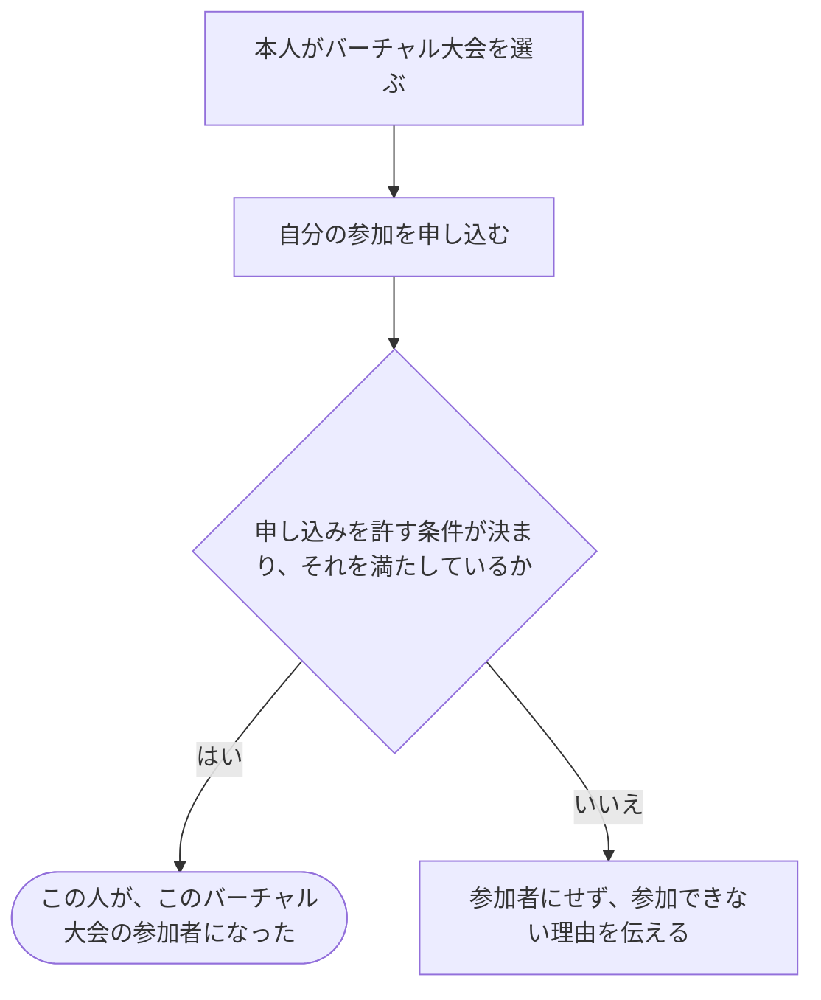

# 好きな時間に挑戦する大会に参加する

[シナリオの一覧へ](../../mutation-scenarios.md)

## したいこと

参加したい人が、自分でバーチャル大会に申し込む。

## 誰が、誰に、何をしてよいか

| 確かめること | この操作での条件 |
| --- | --- |
| 誰が | 未決。本人からの申し込みを許す役割は、ロール定義に記載がない |
| 誰に | 自分自身 |
| 何について | 指定したバーチャル大会1つ |
| 何をする | 参加を申し込み、その大会の参加者（virtual-contestant）になる |

[ロール定義](../../../domain/role.md)には `virtual-contestant` ができることはあるが、その人が自分で参加者になる条件はない。通常の大会への参加条件をそのまま当てはめない。

## 始める前

大会が存在し、本人がログインしていること。申し込みを許す役割と条件を決めるまでは、成功する操作の実装を確定しない。

## 流れ

## できたと言えること

- 条件を決めた後、本人が選んだ大会だけに参加できる。
- 通常の大会の参加資格や、大会を運営する役割を変更しない。
- 申し込み条件が未決な段階で、全員を参加できるようにはしない。

## まだ決めること

- 申し込みを許す役割、公開範囲、参加条件。
- 申し込みと本人の開始時刻をどう結び付けるか。
- 重複した申し込み、再挑戦、参加取り消しの扱い。

## つながる話

- [公開された通常の大会に参加する](join-contest.md)
- [サービス管理者がバーチャル大会の参加資格を付ける](grant-virtual-contestant.md)
- [解答を提出して採点してもらう](../submissions/submit-answer.md)
