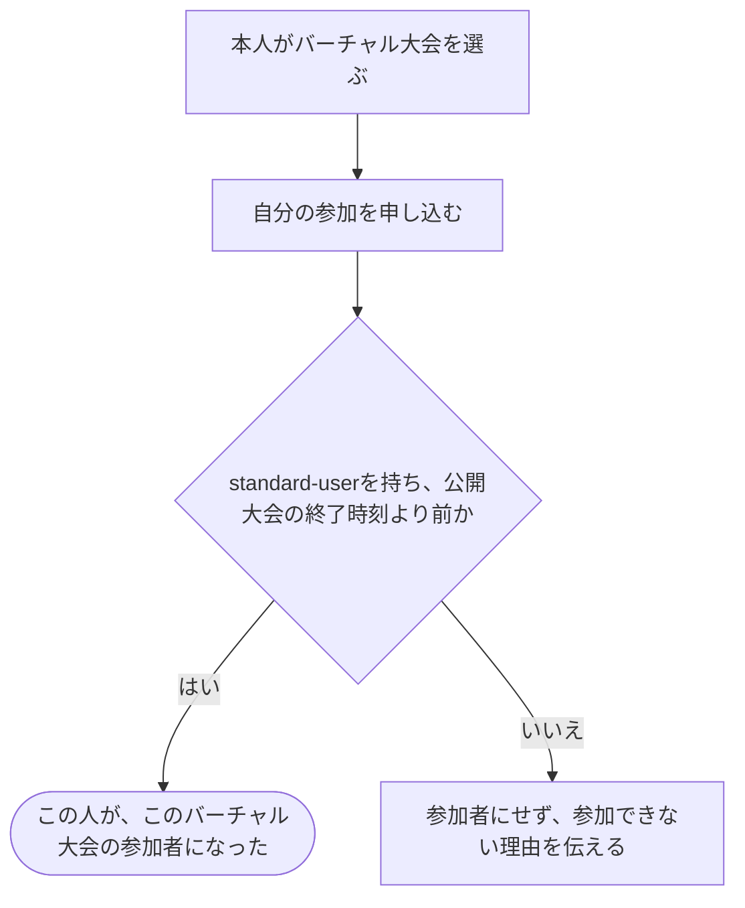

# バーチャル大会に参加する

[シナリオの一覧へ](../../mutation-scenarios.md)

## したいこと

参加したい人が、自分でバーチャル大会に申し込む。

## 誰が、誰に、何をしてよいか

| 確かめること | この操作での条件 |
| --- | --- |
| 誰が | 基本的な利用資格を持つ人（standard-user） |
| 誰に | 自分自身 |
| 何について | 指定したバーチャル大会1つ |
| 何をする | 参加を申し込み、その大会の参加者（virtual-contestant）になる |

[ロール定義](../../../domain/role.md)に従い、公開大会への本人の参加だけを扱う。

## 始める前

大会が公開され、本人がログインしてstandard-userを持つこと。新規参加は終了時刻より前まで可能で、開催中も受け付ける。参加者全員が大会共通の開始・終了時刻を使い、個人別開始・再挑戦は設けない。

## 流れ

## できたと言えること

- 本人が選んだ大会だけに参加できる。
- 通常の大会の参加資格や、大会を運営する役割を変更しない。
- 登録済みの本人の再要求では参加状態を増やさない。

## まだ決めること

- 個人参加の自己取り消し。

## つながる話

- [公開された通常の大会に参加する](join-contest.md)
- [サービス管理者がバーチャル大会の参加資格を付ける](grant-virtual-contestant.md)
- [解答を提出して採点してもらう](../submissions/submit-answer.md)
