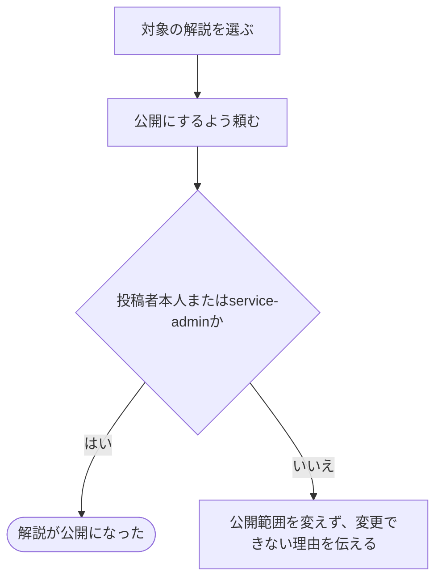

# 解説を公開する

[シナリオの一覧へ](../../mutation-scenarios.md) · [公開範囲を変える話の一覧](share-content.md)

## したいこと

解説を一般に見せたい人が、その解説の公開範囲を変える。

## 誰が、何に、何をしてよいか

| 確かめること | この操作での条件 |
| --- | --- |
| 誰が | 投稿者本人、またはサービス管理者（service-admin） |
| 何に | 指定した解説1つ |
| 何をする | 解説を公開にする |
| 誰への影響か | その解説を公開されていることを理由に閲覧・利用する人 |

[ロール定義](../../../domain/role.md)に従い、投稿者の記録またはservice-adminで判定する。編集担当を任されていることだけでは公開範囲を変更できない。

## 始める前

本人がログインしていて、削除されていない対象が存在すること。本人が投稿者、またはservice-adminであること。

## 流れ

## できたと言えること

- 投稿者本人またはservice-adminが指定した対象だけの公開範囲を変えられる。
- 本文やファイル、担当する人の役割を、この操作で書き換えない。
- 編集担当やログイン済みというだけでは変更できない。

## まだ決めること

- 公開してよい状態・必要な内容と、公開直後に閲覧・利用できる範囲。

## つながる話

- [解説を非公開にする](hide-editorial.md)
- [解説を書く](../others/write-editorial.md)
