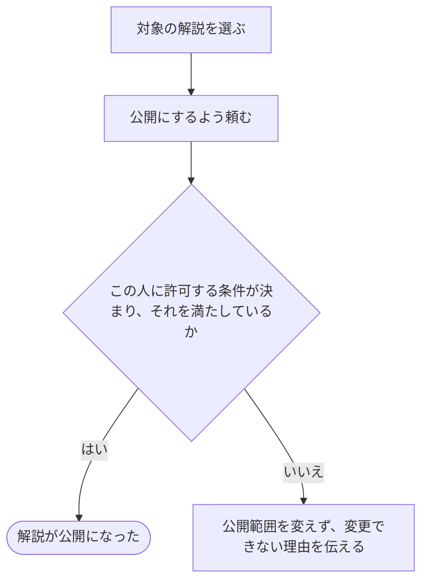

# 解説を公開する

[シナリオの一覧へ](../../mutation-scenarios.md) · [公開範囲を変える話の一覧](share-content.md)

## したいこと

解説を一般に見せたい人が、その解説の公開範囲を変える。

## 誰が、何に、何をしてよいか

| 確かめること | この操作での条件 |
| --- | --- |
| 誰が | 未決。`role.md` に明示された役割がない |
| 何に | 指定した解説1つ |
| 何をする | 解説を公開にする |
| 誰への影響か | その解説を公開されていることを理由に閲覧・利用する人 |

[ロール定義](../../../domain/role.md)では、この操作を許可する人を特定できない。解説を編集できることから公開範囲の変更まで許可されたとは扱わない。

## 始める前

対象が存在すること。許可する役割が未決なので、成功する操作として実装する前に上記を決める。

## 流れ

## できたと言えること

- 許可する人を決めた後、その人が指定した対象だけの公開範囲を変えられる。
- 本文やファイル、担当する人の役割を、この操作で書き換えない。
- 許可条件が未決のものを、ログイン済みというだけで変更できるようにしない。

## まだ決めること

- この操作を誰に許可するか。
- 公開してよい状態・必要な内容と、公開直後に閲覧・利用できる範囲。

## つながる話

- [解説を非公開にする](hide-editorial.md)
- [解説を書く](../others/write-editorial.md)
