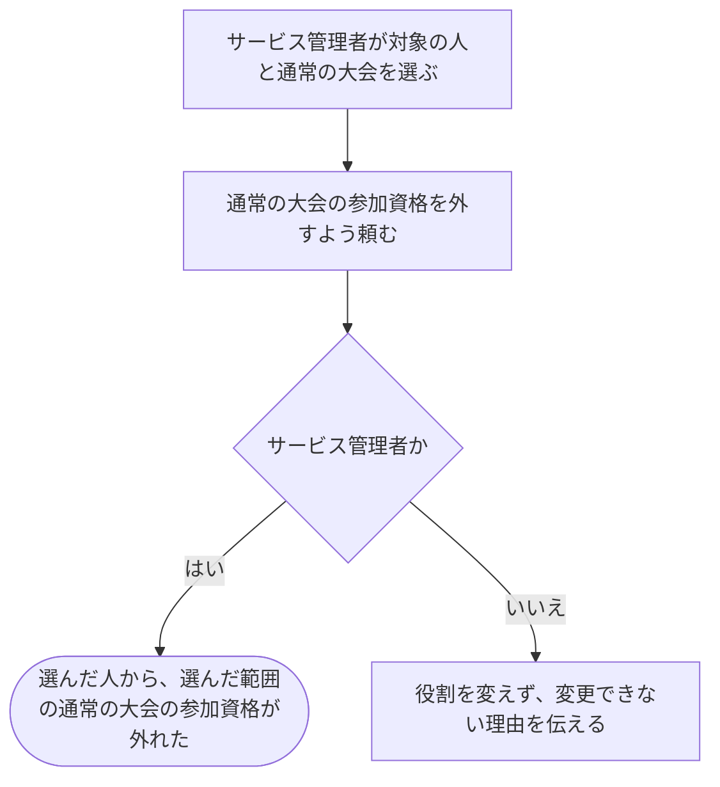

# 人から通常の大会の参加資格を外す

[シナリオの一覧へ](../../mutation-scenarios.md) · [仕事を任せる・外す話の一覧](change-permissions.md)

## したいこと

サービス管理者（service-admin）が、選んだ通常の大会1つについて、登録済みの人から通常の大会の参加資格を外す。

## 誰が、誰に、何をしてよいか

| 確かめること | この操作での条件 |
| --- | --- |
| 誰が | サービス管理者（service-admin） |
| 誰に | その範囲の役割を持つ、登録済みの人 |
| 何について | 選んだ通常の大会1つ |
| 何をする | 選んだ人から `contestant` を外す |
| 外す役割で許されていたこと | その大会の開催時間中に大会内の問題へ提出でき、その大会に質問できる |

根拠は[ロール定義](../../../domain/role.md)の `service-admin`、仕事の範囲は `contestant`。

## 始める前

操作する人がログインしていて、上記の立場を持つこと。対象の人と、対象の通常の大会が存在し、どの人のどの範囲を変えるかが決まっていること。

## 流れ

## できたと言えること

- 選んだ人から、選んだ範囲の通常の大会の参加資格が外れたことが分かる。
- 別の人や、別の通常の大会の役割を変えない。
- この役割を持っているだけの人が、ほかの人から同じ役割を外すことはできない。
- 外すのは指定した役割だけ。他の役割からも同じ操作が許されている場合、その許可まで外したことにはしない。

## まだ決めること

- 編集中や提出処理中に役割を外した場合、いつから操作を止めるか。
- すでに役割が外れている場合の扱いと、複数の役割からの許可を合わせて判断する方法。

## つながる話

- [同じ仕事を任せる](grant-contestant.md)
- [任せる仕事に関係する話](join-contest.md)
