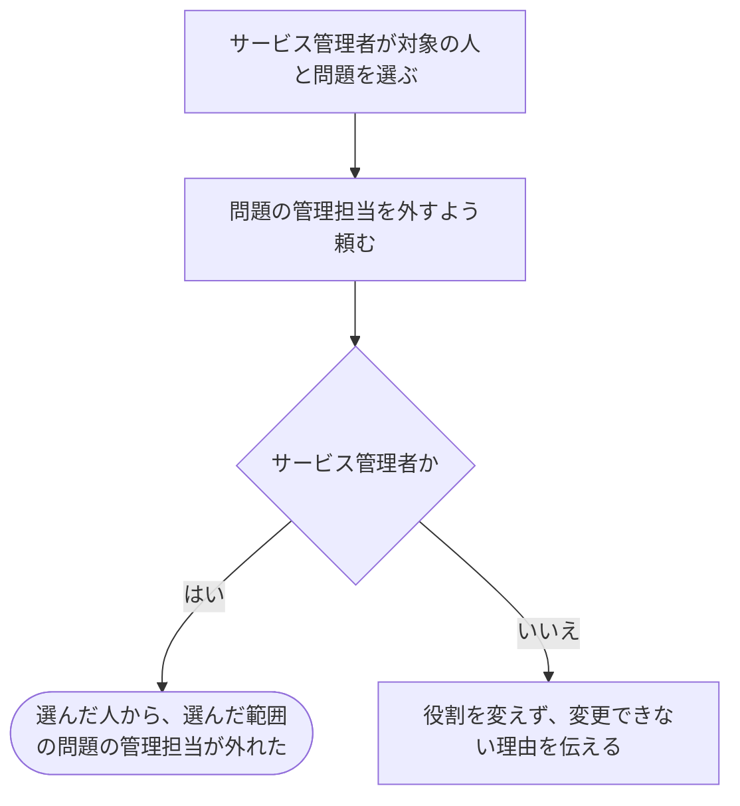

# 人から問題の管理担当を外す

[シナリオの一覧へ](../../mutation-scenarios.md) · [仕事を任せる・外す話の一覧](change-permissions.md)

## したいこと

サービス管理者（service-admin）が、選んだ問題1つについて、登録済みの人から問題の管理担当を外す。

## 誰が、誰に、何をしてよいか

| 確かめること | この操作での条件 |
| --- | --- |
| 誰が | サービス管理者（service-admin） |
| 誰に | その範囲の役割を持つ、登録済みの人 |
| 何について | 選んだ問題1つ |
| 何をする | 選んだ人から `problem-owner` を外す |
| 外す役割で許されていたこと | その問題の閲覧・編集・削除、採点のやり直し、採点方法の追加・更新・削除、テスト担当の追加ができる |

根拠は[ロール定義](../../../domain/role.md)の `service-admin`、仕事の範囲は `problem-owner`。

## 始める前

操作する人がログインしていて、上記の立場を持つこと。対象の人と、対象の問題が存在し、どの人のどの範囲を変えるかが決まっていること。

## 流れ

## できたと言えること

- 選んだ人から、選んだ範囲の問題の管理担当が外れたことが分かる。
- 別の人や、別の問題の役割を変えない。
- この役割を持っているだけの人が、ほかの人から同じ役割を外すことはできない。
- 外すのは指定した役割だけ。他の役割からも同じ操作が許されている場合、その許可まで外したことにはしない。

## まだ決めること

- 編集中や提出処理中に役割を外した場合、いつから操作を止めるか。
- すでに役割が外れている場合の扱いと、複数の役割からの許可を合わせて判断する方法。
- 管理担当の人数、作成直後の担当、担当が0人になる変更の扱い。

## つながる話

- [同じ仕事を任せる](grant-problem-owner.md)
- [任せる仕事に関係する話](../problems/create-problem.md)
