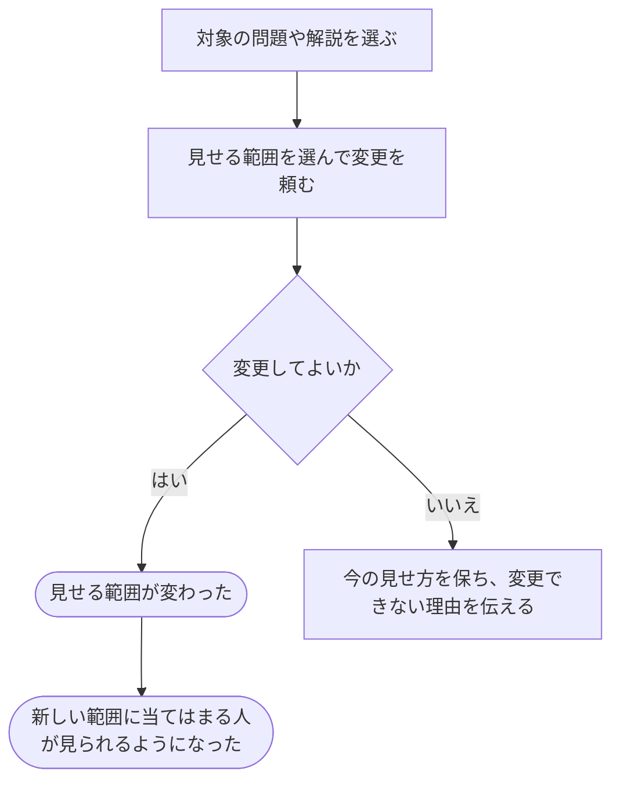

# 問題や解説を見せる相手を変える

[シナリオの一覧へ](../../mutation-scenarios.md)

## したいこと

問題や解説を管理する人が、公開したり、公開をやめたりする。内容を書き換える操作とは分けて、誰に見せるかを変更する。

## 始める前

対象の問題や解説があり、自分が公開範囲を変えられること。

## 流れ

## できたと言えること

- 内容の登録と、見せる範囲の変更をそれぞれ行える。
- 変更が認められた後は、新しい公開範囲に従う。
- 変更できないときは、それまでの公開範囲を保つ。

## まだ決めること

- 問題を公開できるために、何がそろっている必要があるか。
- 公開をやめた問題を、大会の参加者や過去に提出した人がどこまで使えるか。

## つながる話

- [手元で作った問題のファイルを登録する](../problems/upload-problem-files.md)
- [解説を書き、直す・取り下げる](../others/write-editorial.md)
- [解答を提出して採点してもらう](../submissions/submit-answer.md)
