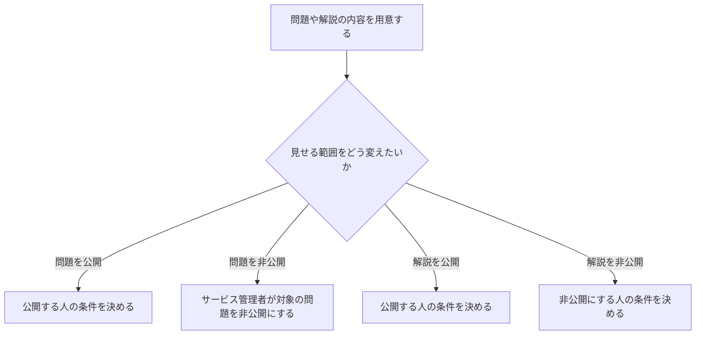

# 問題や解説を見せる相手を変える

[シナリオの一覧へ](../../mutation-scenarios.md) · [すべての操作の許可条件](../../permission-operations.md)

対象と変更する向きを分ける。役割を付ける操作とは別の話であり、内容を編集できる人が公開範囲も変えてよいとは限らない。

| 番号 | 操作ごとの話 | 誰がしてよいか |
| --- | --- | --- |
| R2-01 | [問題を公開する](publish-problem.md) | 未決 |
| R2-02 | [問題を非公開にする](hide-problem.md) | サービス管理者（service-admin）はすべての問題に対して実行できる。他の役割は未決 |
| R2-03 | [解説を公開する](publish-editorial.md) | 未決 |
| R2-04 | [解説を非公開にする](hide-editorial.md) | 未決 |

根拠は[ロール定義](../../../domain/role.md)。条件が未決の話は、実装時に担当者ごとの判断で許可を補わず、合意が必要な話として残す。
