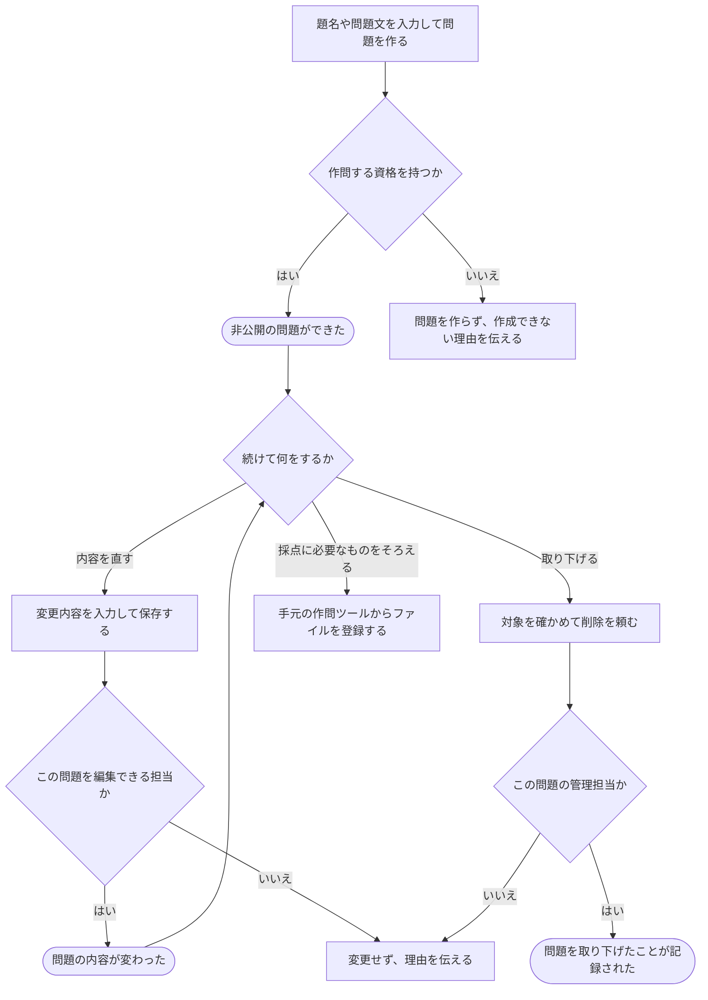

# 新しい問題を作り、内容を直す・取り下げる

[シナリオの一覧へ](../../mutation-scenarios.md)

## したいこと

問題を作る人が、題名や問題文を書いて、まず非公開の問題を用意する。すでにある問題は、編集できる人が内容を直したり、削除できる人が取り下げたりする。

## 誰が、誰に、何をしてよいか

| 操作 | 誰が | 誰に／何に・範囲 |
| --- | --- | --- |
| 新しい問題を作る（P1-01） | 作問する資格を持つ人（writer） | 新規の問題 |
| 題名・問題文を編集する（P1-02） | 問題Pの problem-owner / tester、またはPを含む通常大会Cの contest-setter | その問題P |
| 問題を削除する（P1-03） | 問題Pの problem-owner | その問題P |

根拠は[ロール定義](../../../domain/role.md)。書かれていない役割の許可は補わない。全操作の対応は[許可条件の一覧](../../permission-operations.md)を参照する。

## 始める前

本人がログインし、新規作成には `writer` を持つこと。編集には対象の問題の `problem-owner` / `tester`、またはその問題を含む通常大会の `contest-setter` を持つこと。削除には対象の問題の `problem-owner` を持つこと。作成しただけで管理担当も自動で付くかは未決。

## 流れ

## できたと言えること

- 新しく作った問題は、非公開になっている。
- 編集できる人が、題名や問題文を変更できる。
- 問題を取り下げても、問題があったことや提出・解説などの過去の記録を残す。
- できない立場の人から頼まれた場合は、内容を変えない。

## まだ決めること

- 新しく問題を作った人に、最初からどこまでの仕事を任せるか。
- 複数の人が同時に内容を直した場合の扱い。
- 取り下げた問題を、過去に提出した人や大会の参加者にどう見せるか。

## つながる話

- [できることを増やす・減らす](../permissions/change-permissions.md)
- [手元で作った問題のファイルを登録する](upload-problem-files.md)
- [問題や解説を見せる相手を変える](../permissions/share-content.md)
