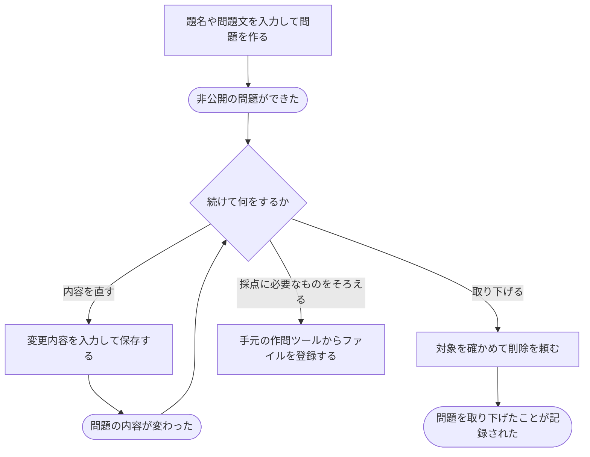

# 新しい問題を作り、内容を直す・取り下げる

[シナリオの一覧へ](../../mutation-scenarios.md)

## したいこと

問題を作る人が、題名や問題文を書いて、まず非公開の問題を用意する。すでにある問題は、編集できる人が内容を直したり、削除できる人が取り下げたりする。

## 始める前

新しく作る人は、問題を作れる立場であること。既存の問題を直す・取り下げる人は、その操作をしてよいこと。

## 流れ

## できたと言えること

- 新しく作った問題は、非公開になっている。
- 編集できる人が、題名や問題文を変更できる。
- 問題を取り下げても、問題があったことや提出・解説などの過去の記録を残す。
- できない立場の人から頼まれた場合は、内容を変えない。

## まだ決めること

- 新しく問題を作った人に、最初からどこまでの仕事を任せるか。
- 複数の人が同時に内容を直した場合の扱い。
- 取り下げた問題を、過去に提出した人や大会の参加者にどう見せるか。

## つながる話

- [できることを増やす・減らす](../permissions/change-permissions.md)
- [手元で作った問題のファイルを登録する](upload-problem-files.md)
- [問題や解説を見せる相手を変える](../permissions/share-content.md)
