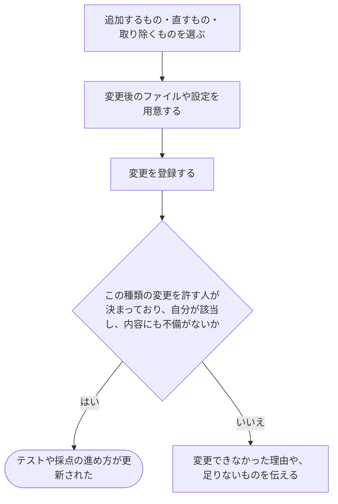

# テストや採点の進め方を直す

[シナリオの一覧へ](../../mutation-scenarios.md)

## したいこと

問題を編集する人が、テストを増やしたり、誤った正解データを直したり、採点に使うプログラムや進め方を変更したりする。

## 誰が、誰に、何をしてよいか

| 操作 | 誰が | 誰に／何に・範囲 |
| --- | --- | --- |
| テストを追加する（P3-01） | 未決。問題の更新に含めるかを role.md だけでは特定できない | 問題Pのテスト |
| テストを編集する（P3-02） | 未決。問題の更新に含めるかを role.md だけでは特定できない | 問題Pの指定したテスト |
| テストを削除する（P3-03） | 未決。問題の更新に含めるかを role.md だけでは特定できない | 問題Pの指定したテスト |
| 採点方法を追加する（P3-04） | 問題Pの problem-owner | その問題P |
| 採点方法を更新する（P3-05） | 問題Pの problem-owner / tester、またはPを含む通常大会Cの contest-setter | 問題Pに属する、指定した採点方法 |
| 採点方法を削除する（P3-06） | 問題Pの problem-owner、または service-admin | 指定した採点方法。service-admin は全問題のものが対象 |

根拠は[ロール定義](../../../domain/role.md)。書かれていない役割の許可は補わない。全操作の対応は[許可条件の一覧](../../permission-operations.md)を参照する。

## 始める前

本人がログインし、対象の問題と、追加・更新・削除のどれを行うかが決まっていること。上表で未決の操作は、許可する人を決めるまで成功する操作として扱わない。

## 流れ

## できたと言えること

- 問題の管理担当は採点方法を追加・更新・削除できる。テスト担当と、その問題を含む通常大会の運営担当は更新だけができる。
- サービス管理者は、担当していない問題の採点方法も記録を残して削除できる。その役割だけで追加・更新する許可はない。
- テストの変更は、許可する人を合意してから実装する。
- 必要なファイルや設定に不備があれば、変更できたことにしない。
- すでに始まっている採点が、途中で別の内容に切り替わらない。

## まだ決めること

- 作問ツールからまとめて登録する方法に加えて、画面から個別に直す方法をどこまで用意するか。
- テストの追加・編集・削除を、問題の更新の許可に含めるか。採点方法の許可は上表のとおり区別する。
- 管理担当による採点方法の削除でも記録を残すか。サービス管理者による削除は記録を残す。
- 変更後の内容で、過去の提出を採点し直すまでの操作をどうつなぐか。

## つながる話

- [手元で作った問題のファイルを登録する](upload-problem-files.md)
- [前の提出をもう一度採点してもらう](../submissions/judge-again.md)
