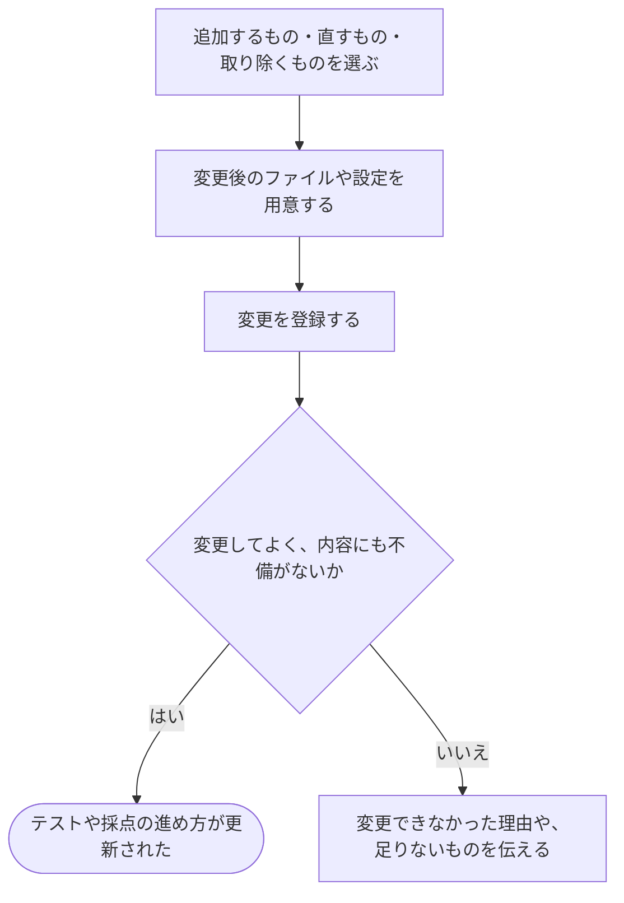

# テストや採点の進め方を直す

[シナリオの一覧へ](../../mutation-scenarios.md)

## したいこと

問題を編集する人が、テストを増やしたり、誤った正解データを直したり、採点に使うプログラムや進め方を変更したりする。

## 始める前

対象の問題があり、行いたい変更が許されていること。変更したいテストや採点方法が分かっていること。

## 流れ

## できたと言えること

- 許された範囲で、テストや採点方法を変更できる。
- 必要なファイルや設定に不備があれば、変更できたことにしない。
- すでに始まっている採点が、途中で別の内容に切り替わらない。

## まだ決めること

- 作問ツールからまとめて登録する方法に加えて、画面から個別に直す方法をどこまで用意するか。
- 追加・修正・削除のそれぞれを、誰が行えるようにするか。
- 変更後の内容で、過去の提出を採点し直すまでの操作をどうつなぐか。

## つながる話

- [手元で作った問題のファイルを登録する](upload-problem-files.md)
- [前の提出をもう一度採点してもらう](../submissions/judge-again.md)
