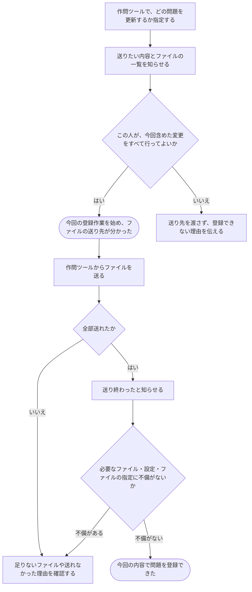

# 手元で作った問題のファイルを登録する

[シナリオの一覧へ](../../mutation-scenarios.md)

## したいこと

問題を作る人が、手元の作問ツールから、テストの入出力や採点用のプログラム、採点の進め方をまとめて送る。必要なものがそろい、指定にも不備がないと確認できたら、今回の内容で登録を終える。

## 誰が、誰に、何をしてよいか

| 操作 | 誰が | 誰に／何に・範囲 |
| --- | --- | --- |
| CLIで登録を始め、送り先を受け取る（P2-01） | 本人の有効な作問ツールの認証手段を使う人。下記の各変更の許可も必要 | 対象の問題Pと、今回登録する内容 |
| CLIでファイルを送り、登録を完了する（P2-02） | 登録を始めた本人。問題・採点方法それぞれの変更の許可が必要 | 自分が開始した登録と問題P |

根拠は[ロール定義](../../../domain/role.md)。書かれていない役割の許可は補わない。全操作の対応は[許可条件の一覧](../../permission-operations.md)を参照する。

## 始める前

対象の問題があり、作問ツールを自分の名前で使えること。今回の変更に必要な許可をすべて持つこと。問題文の更新は問題の管理担当・テスト担当・その問題を含む通常大会の運営担当が行えるが、採点方法の新規追加は問題の管理担当だけが行える。テストごとの許可は未決。送りたいファイルと、どのファイルを何に使うかの設定が手元にあること。

## 流れ

## できたと言えること

- 必要なファイルがそろい、説明や設定、使うファイルの指定にも不備がないと確認できた時点で、登録が完了する。
- 何かが足りない場合は、今回の内容を登録できたことにしない。
- 前回と今回の内容を区別して残し、すでに始まっている採点に使う内容を勝手に差し替えない。
- 登録完了と、公開範囲を変える操作を別々に行える。
- 一式の登録でも、含まれる変更ごとの許可を確認する。テスト担当による採点方法の新規追加・削除を、まとめて送る方法で許可しない。
- 他の人が始めた登録に、自分のファイルを混ぜて完了できない。

## まだ決めること

- どの設定やファイルの指定を、どの条件で不備とするか。
- 一式の登録から追加・更新・削除をどう判別するか。テストの変更を誰に許可するかと、一部の変更だけが許可される場合の扱い。
- 別の人も同時に更新していた場合や、途中で編集できる立場ではなくなった場合の扱い。
- 通信が切れ、同じ完了のお知らせがもう一度届いた場合の扱い。

## つながる話

- [手元の作問ツールを使えるようにする・使えなくする](../authentication/use-authoring-tool.md)
- [新しい問題を作り、内容を直す・取り下げる](create-problem.md)
- [問題や解説を見せる相手を変える](../permissions/share-content.md)
- [テストや採点の進め方を直す](edit-tests-and-judging.md)
