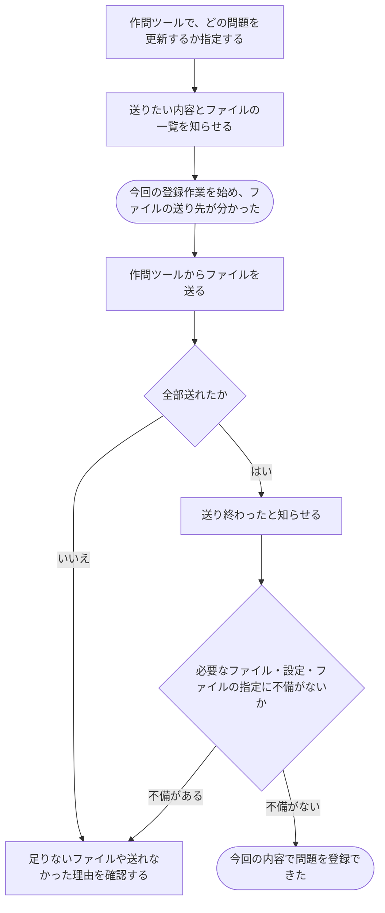

# 手元で作った問題のファイルを登録する

[シナリオの一覧へ](../../mutation-scenarios.md)

## したいこと

問題を作る人が、手元の作問ツールから、テストの入出力や採点用のプログラム、採点の進め方をまとめて送る。必要なものがそろい、指定にも不備がないと確認できたら、今回の内容で登録を終える。

## 始める前

対象の問題が作られていて、その問題を編集できること。作問ツールを自分の名前で使えること。送りたいファイルと、どのファイルを何に使うかの設定が手元にあること。

## 流れ

## できたと言えること

- 必要なファイルがそろい、説明や設定、使うファイルの指定にも不備がないと確認できた時点で、登録が完了する。
- 何かが足りない場合は、今回の内容を登録できたことにしない。
- 前回と今回の内容を区別して残し、すでに始まっている採点に使う内容を勝手に差し替えない。
- 登録完了と、公開範囲を変える操作を別々に行える。

## まだ決めること

- どの設定やファイルの指定を、どの条件で不備とするか。
- 別の人も同時に更新していた場合や、途中で編集できる立場ではなくなった場合の扱い。
- 通信が切れ、同じ完了のお知らせがもう一度届いた場合の扱い。

## つながる話

- [手元の作問ツールを使えるようにする・使えなくする](../authentication/use-authoring-tool.md)
- [新しい問題を作り、内容を直す・取り下げる](create-problem.md)
- [問題や解説を見せる相手を変える](../permissions/share-content.md)
- [テストや採点の進め方を直す](edit-tests-and-judging.md)
